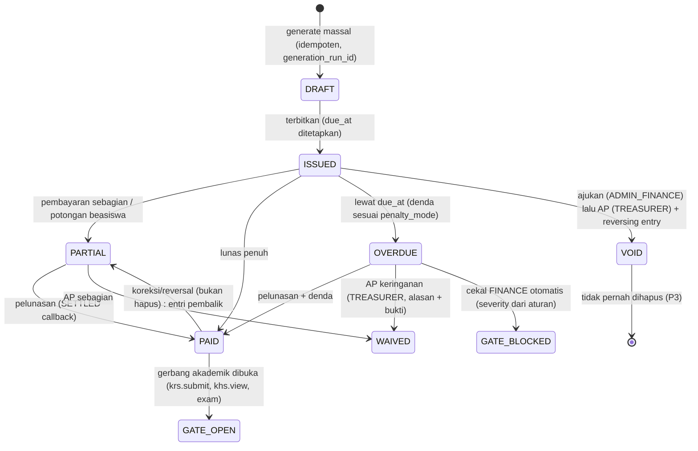
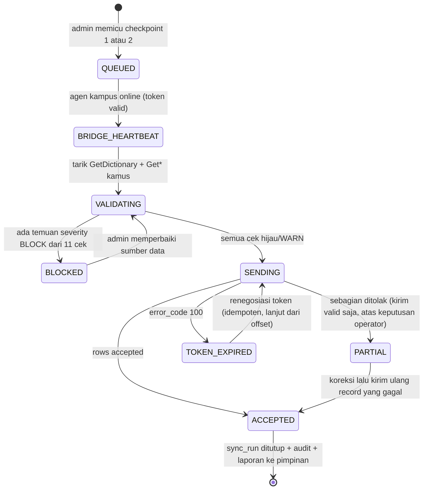
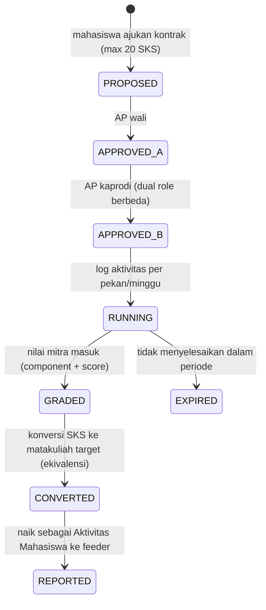

# SICA — Cetak Biru Enterprise (Hasil Dekonstruksi Sevima SIAKAD Enterprise)

| | |
|---|---|
| **Status** | Cetak biru utama pembangunan platform (dokumen kerja, aktif) |
| **Versi** | 1.0 — 2026-10-19 |
| **Disusun oleh** | Principal Systems Architect · Lead Business Analyst · Domain Expert SIAKAD Enterprise |
| **Deliverable** | (1) Matriks RBAC Role × Modul × Aksi · (2) Tree struktur menu & sub-menu per peran · (3) Field & attribute data requirements untuk skema PostgreSQL · (4) State machine / workflow diagram |
| **Dokumen kanonik yang tidak boleh ditabrak** | [RBAC_MATRIX.md](file:///c:/SICA/docs/RBAC_MATRIX.md) (sumber kebenaran hak akses) · [DATA_MODEL.md](file:///c:/SICA/docs/DATA_MODEL.md) (skema) · [API_SPEC.md](file:///c:/SICA/docs/API_SPEC.md) (kontrak) · [UI_UX_DESIGN.md](file:///c:/SICA/docs/UI_UX_DESIGN.md) (IA & styling Velzon) · [PRD.md](file:///c:/SICA/docs/PRD.md) (FR/BR/AC) · [BENCHMARK_SEVIMA.md](file:///c:/SICA/docs/BENCHMARK_SEVIMA.md) (bukti pembanding) |
| **Bahasa** | Indonesia (kode, nama tabel/kolom, konvensi API tetap Inggris) |

---

## 0. Cara membaca dokumen ini

### 0.1 Posisi
Dokumen ini adalah **lapis analisis** (dekonstruksi + cetak biru), bukan lapisan norma. Bila dokumen ini bertentangan dengan dokumen kanonik, dokumen kanonik yang menang, dan kontradiksinya wajib dilaporkan ke Principal Lead Architect untuk direkonsiliasi — bukan dibiarkan dua versi.

### 0.2 Penanda keyakinan (warisan [BENCHMARK_SEVIMA §0.1](file:///c:/SICA/docs/BENCHMARK_SEVIMA.md))
| Penanda | Arti |
|---|---|
| `[DOK]` | Dokumentasi resmi Sevima / kamus data PDDikti (kutipan) |
| `[PUB]` | Halaman produk/harga Sevima |
| `[PIHAK-KETIGA]` | Panduan kampus pengguna, PDF panduan, jurnal, repo integrator |
| `[INF]` | Rekonstruksi arsitektural dari pola yang terlihat — **wajib diverifikasi sebelum dijadikan requirement** |
| `[KODE]` | Kondisi SICA terverifikasi dari repositori (skema Drizzle, enum, rute) |
| `[USUL]` | Keputusan desain SICA yang saya ajukan di dokumen ini (belum ada di kode) |

### 0.3 Penanda status kesiapan SICA
| Simbol | Arti |
|---|---|
| ✅ | Sudah ada di kode dan teruji |
| ◐ | Sebagian (skema/kontrak ada, sisi lain belum) |
| ❌ | Belum ada sama sekali |
| 🧩 | Perlu objek/peran baru (butuh keputusan produk sebelum kode) |

### 0.4 Kosakata aksi (10 aksi yang diminta → 6 aksi kanonik SICA)
Permintaan analisis memakai 10 aksi. SICA menyimpan izin sebagai `resource × verb` dengan **enam** verb (`READ/INSERT/UPDATE/DELETE/VALIDATE/OTHER`) — hasil adopsi benchmark ([SECURITY §3.3](file:///c:/SICA/docs/SECURITY_COMPLIANCE.md), [DATA_MODEL §14.4](file:///c:/SICA/docs/DATA_MODEL.md), `FR-IDT-04`). Pemetaan resmi, **berlaku di seluruh dokumen ini**:

| Aksi analisis | Verb kanonik | Verba kode (`RBAC_MATRIX` §4) | Catatan penegakan |
|---|---|---|---|
| CREATE | `INSERT` | `create`, `generate`, `submit`, `propose`, `request`, `record` | Semua tulis master & transaksi |
| READ | `READ` | `view`, `list` | Masking PII berlaku di layer ini |
| UPDATE | `UPDATE` | `update`, `manage`, `write`, `assign`, `configure` | Wajib `before/after` di `audit_logs` |
| DELETE | `DELETE` | `delete`, `revoke`, `release` | Rekam akademik & data terkirim **tidak boleh** hard delete (BR-R10) |
| APPROVE | `VALIDATE` | `approve`, `validate`, `confirm` | Persetujuan; pemohon ≠ penyetuju (SoD) |
| REJECT | `VALIDATE` | `reject` | **Aksi ber-alasan wajib**; bukan state tanpa sebab (lihat §5 workflow) |
| EXPORT | `OTHER` | kode ekspor yang terdaftar eksplisit | Bukan izin global; scope, kolom, volume, jejak audit dan rate limit wajib |
| LOCK | `UPDATE` | `lock` | Mengunci (nilai/periode/transkrip) |
| UNLOCK | `VALIDATE` | `unlock` | **Melepas** kunci = keputusan otoritas lebih tinggi, bukan `UPDATE` biasa |
| DISPENSE/override | `VALIDATE` | `dispense`, `override`, `waive` | Keringanan, dispensasi tagihan, override gerbang KRS |

**Kenapa `UNLOCK` dan `REJECT` masuk `VALIDATE`, bukan `UPDATE`:** keduanya **mengubah keadaan yang sudah disahkan**. Kalau keduanya cukup `UPDATE`, seorang admin kelas bisa membuka kunci nilai sendiri — pola fraud klasik yang di SICA dilarang (PRD P2/P5, `BR-G4`). Konsekuensi implementasi: `roles`/`role_permissions` **wajib** memisahkan grant `grading.lock` (`UPDATE`) dari `grading.unlock` (`VALIDATE`) dan `krs.approve` dari `krs.reject`. `[KODE]` pemisahan kode **sudah** terpenuhi (ketiganya adalah kode `resource` berbeda di `PERMISSION_SPECS`, dan `unlock` hanya digran ke `HEAD_OF_PROGRAM`); yang **belum** adalah verb `grading.unlock` yang masih tersimpan `UPDATE` — lihat celah **K-5** §6.0.

---

## 1. Kerangka hasil dekonstruksi Sevima Enterprise

### 1.1 Bentuk permukaan aplikasi `[DOK]`
Sevima tidak mengirim satu "aplikasi admin". Admin masuk ke **SEVIMA Platform** (SSO, domain `<kampus>.siakadcloud.com`/`<kampus>.sevimaplatform.com`), **memilih peran**, lalu masuk ke **modul**. Modul yang terpetakan (rujuk [BENCHMARK §2A.3](file:///c:/SICA/docs/BENCHMARK_SEVIMA.md)): `Akademik`, `Keuangan Akademik`, `SPMB/PMB`, `CBT`, `SIM Kepegawaian`, `EdLink`, `ProFeeder/GoFeeder`, `SPMI/Akreditasi Cloud`, `MBKM`, `Litabmas`, `Karirlink/Tracer`, `SIMKERMA`, `Persuratan`, `E-Sign`, `Dashboard Pimpinan`, `MauKuliah`, dan console **`Administrasi Aplikasi`** (user, hak akses, log, pengaturan, kustomisasi, backup, `Login As`).

Navigasi inti Akademik `[DOK]`: `Portal (Mahasiswa | Pegawai)` · `Perkuliahan (Data Kurikulum | Data Kelas | Administrasi | Data Tugas Akhir | Kegiatan Pendukung | Integrasi PD-DIKTI)` · `Data Pelengkap` (6 kategori master) · `Laporan` · `Setting (Setting Prodi | Periode Akademik | Setting Aplikasi | Kalender Akademik | Skala Nilai | Komposisi Nilai)`.

### 1.2 Sifat granularitas otoritas Sevima yang kita tiru — dan yang kita lewati
| Sifat Sevima | Nilai bagi kampus | Keputusan SICA |
|---|---|---|
| Izin per **(aplikasi × peran)** dengan 6 aksi | Administratif, bisa dipakai lintas modul | **Diadopsi** (`resource × verb`), tetapi **resource** kita berjenjang (`modul.objek.aksi`) agar satu layar = satu titik aksi |
| Peran tambahan dapat dibuat Admin PT | Fleksibel | **Diadopsi** lewat `roles.is_system=false`, dengan grant hanya dari katalog `RBAC_MATRIX` §4 |
| Hak orang tua dapat disetel admin | Perlu (privasi anak) | **Diadopsi** sebagai consent eksplisit di sisi mahasiswa + scope `GUARDIAN` |
| `Login As` tanpa jejak justifikasi | Dukungan cepat | **Ditolak** → impersonation ber-alasan + MFA + TTL 30 menit + audit (`FR-ADM-13`) |
| Reset password = tanggal lahir | Mudah | **Ditolak** (postur UU PDP) → token sekali pakai |
| Kustomisasi kolom/laporan harus lewat tiket vendor | Konsisten | **Ditolak** → `FR-ADM-09` meta-konfigurasi mandiri ber-audit |
| Pembatasan akses via `Unit/Satuan Kerja` + kode unit angka | Warisan | **Ditolak** → `user_role_assignments.scope_*` + `tenant_id` + RLS |

---

## 2. DELIVERABLE 1 — Matriks hak akses (peran × modul × aksi)

### 2.1 Sepuluh peran yang diminta → katalog peran SICA
Sepuluh peran permintaan analisis **tidak dipetakan satu-satu menjadi role baru** (itu penyebab ledakan peran di pembanding). Sebagian adalah **peran**, sebagian adalah **atribut data/scope**.

| # | Peran diminta | Wujud di SICA | Kode | Status |
|---|---|---|---|---|
| 1 | Super Admin / Administrator IT | **Peran platform** (bukan admin kampus) + **Admin Aplikasi tenant** | `PLATFORM_OPERATOR` (enum `super_admin`) + `TENANT_ADMIN` | ◐ wadah siap — `ROLE_CODES` + tabel `roles`/`role_permissions`/`user_role_assignments` ada di `[rbac.ts](file:///C:/SICA/packages/database/src/schema/rbac.ts)`; ✅ migrasi `0011` diterapkan di DB dev (pooler PG 17.11, rantai 7/7, bukti `PROGRESS_REPORT §5.65–§5.66`, 2026-10-23) · ❌ layar |
| 2 | Admin Akademik (BAAK) | Peran institusi scope `ORG`/lintas prodi | `ADMIN_ACADEMIC` | ✅ peran (`ROLE_CODES` + grant) · ❌ layar `/admin/**` |
| 3 | Admin Keuangan & Kepegawaian (BAUK) | **Dua peran terpisah** (keuangan dipecah lagi untuk SoD) + satu untuk kepegawaian | `ADMIN_FINANCE` · `TREASURER` · `HR_BKD_OFFICER` | ◐ sebagian (`ADMIN_FINANCE` belum dilayani) |
| 4 | Kaprodi & Dekan / Pimpinan Fakultas | **Dua peran berbeda scope**: kaprodi `PROGRAM`, dekan `ORG` (fakultas) | `HEAD_OF_PROGRAM` · **`DEKAN`** `[USUL]` | ✅ kaprodi (`ROLE_CODES` + seed) · 🧩 dekan belum ada |
| 5 | Dosen Pengampu | Peran scope `CLASS` (dari `class_assignments`) | `LECTURER` (atribut `COORDINATOR`, `LAB_ASSIST`, `EXAMINER`) | ✅ berjalan |
| 6 | Dosen Pembimbing Akademik (Wali) | Peran scope `PERIOD`+sekelompok mahasiswa | `ADVISER` | 🟡 guard terpasang — `requirePermission(ctx, PERM.enrollmentKrsApprove)` di [krs/approve/route.ts:26](file:///C:/SICA/apps/web/src/app/api/v1/academic/krs/approve/route.ts#L26), **tetapi** ia membaca perluasan carrier (`evaluateAccess` → `rolesOf`), bukan `user_role_assignments`; pemindahan ke `requireDataPrincipal` + scope nyata menunggu `0011` diterapkan (G-02/G-04) |
| 7 | Mahasiswa (reguler · non-reguler · transfer · MBKM) | **Satu peran `STUDENT`**; keempatnya **atribut skema enrollment**, bukan peran | `STUDENT` + `enrollment_schemes.code` ∈ `REGULER`, `NON_REGULER`, `PINDAHAN`, `RPL`, `MBKM` | ✅ peran · 🧩 skema (FR-ADM-08) |
| 8 | Orang Tua / Wali | Peran `SELF` tertaut (`student_guardians` + consent) | `GUARDIAN` | ✅ wadah siap — ada di `ROLE_CODES` + grant + seed `0011`; ❌ portal & relasi `student_guardians` belum (W-12.2) |
| 9 | Admin PMB | Peran scope `ORG` pada modul add-on | `PMB_OPERATOR` | 🧩 **tidak ada di `ROLE_CODES`** (17 peran, tanpa PMB) — perlu keputusan produk; portal PMB masih W-12.3 |
| 10 | Admin Kemahasiswaan & Alumni | **Dua peran**: kemahasiswaan (`ORG`) dan alumni (`SELF` pembaca + `ORG` pengelola) | **`STUDENT_AFFAIRS_OFFICER`** `[USUL]` · `ALUMNI_MANAGER` `[USUL]` (portal `ALUMNI` sudah ada) | 🧩 belum tercakup katalog 22 |

**Tiga keputusan arsitektural dari tabel di atas:**
1. **`DEKAN` perlu menjadi peran sendiri** `[USUL]`, bukan `LEADER` biasa. Alasan fungsional: dekan adalah **penyetuju tingkat fakultas** (usulan kelas paralel, cuti akademik, dispensasi KRS lintas prodi di fakultasnya, pengusulan yudisium ke rektorat) dan butuh **agregat per fakultas**. `LEADER` bersifat read-agregat + e-sign (PRD persona "Pimpinan"), tidak menulis data operasional. Cakupan scope: `ORG` (fakultas) yang menyerap banyak `PROGRAM` di bawahnya — hanya model `user_role_assignments.scope_org_id` yang bisa mengekspresikan ini.
2. **Kemahasiswaan bukan varian akademik.** Aktivitas/prestasi/pelanggaran/sanksi/beasiswa adalah siklus tersendiri (di Sevima: menu `Kemahasiswaan > Aktivitas`), dan **memegang kunci IKU 2** serta `blockades` dimensi `STUDENT_AFFAIRS`. Peran `STUDENT_AFFAIRS_OFFICER` + modul `student_affairs` `[USUL]` diminta; saat ini katalog 19 modul SICA **tidak punya** modul kemahasiswaan — ini celah produk nyata (`G-11`).
3. **Empat jenis mahasiswa jangan dijadikan empat peran.** Beda reguler/non-reguler/transfer/MBKM = beda **skema** (hak ambil kelas, tarif, konversi SKS, batas masa studi), bukan beda hak atas layar. Menjadikannya peran = 4× matriks izin dan 4× bug gating. Yang berubah bagi `STUDENT` hanya apa yang boleh ia **kirim** (mis. mahasiswa MBKM mengirim log aktivitas mitra, bukan KRS biasa).

### 2.2 Legenda matriks §2.3–§2.9
`C` create · `R` read · `U` update · `D` delete sesuai kontrak (rekam akademik/terpakai: nonaktif/arsip, bukan hard delete) · `AP` approve · `RJ` reject (alasan wajib) · `X` ekspor eksplisit · `LK` lock · `UL` unlock (`VALIDATE`) · `DS` dispense/override/waive · `P` penuh C R U D dalam scope · `B` baca saja · `A` agregat · `—` tidak ada hak.
Sel ber-penanda **(sc)** berarti hak hanya di dalam scope role (prodi/fakultas/kelas/periode/milik diri). **Sel tanpa (sc) tidak berarti tanpa batas scope.**

**Ralat administrator yang mengikat seluruh matriks lama:** kolom `PLAT`/`T-ADM` pada §2.3–§2.8 merekam analisis/grant legacy, **bukan template grant target**. `P`, `AP`, `UL`, dan akses nominal bisnis di kolom IT tidak berlaku sebagai kewenangan hanya karena label admin. Target menggantikannya dengan batas §2.11/`RBAC §6.8`: platform mengelola SaaS, tenant IT mengelola binding teknis; KRS/nilai/pembayaran dan kebijakan domain tetap di pemilik bisnis. Migrasi grant/guard/cache dan uji negatif masih diperlukan; dokumen ini tidak menyatakan hak terpasang telah dicabut.

### 2.3 Modul A — Master Data & Setting Sistem
| Objek / layar | PLAT | T-ADM | A-AKA | KEU | SDM | DEKAN | KAPRODI | DOSEN | WALI | MHS | ORTU | PMB | KEMAH | ALUMNI |
|---|---|---|---|---|---|---|---|---|---|---|---|---|---|---|
| Profil PT (kode PDDikti, akreditasi PT, pejabat, penandatangan) | `P` | `R U` | `R` | `R` | `R` | `R` | `R` | — | — | — | — | `R` | `R` | — |
| Fakultas / Jurusan / Unit / Laboratorium | `P` | `P (sc=tenant)` | `C R U D (sc=org)` | `R` | `R` | `R U (sc=org)` | `R (sc=prodi)` | — | — | — | — | `R` | `R` | — |
| Program studi (jenjang, kode prodi, akreditasi, plafon SKS nasional) | `P` | `P` | `C R U` | `R` | `R` | `R U (sc=org)` | `R (sc=prodi)` | `R` | `R` | `R` | — | `R U` | `R` | `R` |
| Tahun akademik | `P` | `P` | `R C U` | `R` | `R` | `R` | `R C U (sc=prodi)` | `R` | `R` | `R` | `R` | `R C` | `R` | — |
| Periode / semester + buka-tutup | `P` | `P` + `AP`/`UL` reopen | `R C U` + `AP` | `R` | `R` | `R AP` | `R U (sc=prodi)` | `R` | `R` | `R` | `R` | `R U` | `R` | — |
| Kalender akademik (tanggal kunci + libur + tenggat PDDikti) | `P` | `P` | `C R U D` | `R` | `R` | `R` | `C R U (sc=prodi)` | `R` | `R` | `R` | `R` | `R` | `R` | — |
| Jam kuliah / slot waktu ( blok 1–16, hari × jam) | `P` | `P` | `C R U D` | — | — | `R` | `C R U (sc=prodi)` | `R` | — | `R` | — | — | — | — |
| Gedung & ruangan (kapasitas, tipe lab/kelas, fasilitas) | `P` | `P` | `C R U D` | `R` | `R` | `R` | `R U (sc=prodi)` | `R` | — | `R` | — | — | `R` | — |
| Skema enrollment (reguler/non-reguler/pindahan/RPL/MBKM) | `P` | `P` | `C R U` | `R U` (tarif terkait) | `R` | `R` | `C R U (sc=prodi)` | `R` | `R` | `R` | — | `R` | `R` | — |
| Kurikulum (versi, masa berlaku, jumlah SKS lulus) | `P` | `R C U` | `C R U D (sc=org)` | — | — | `R AP` | `P (sc=prodi)` + `AP` | `R` | `R` | `R` | — | `R` | — | — |
| Mata kuliah (SKS teori/praktik/praktik-lapangan/simulasi, tipe, bahasa) | `P` | `R C U` | `C R U D (sc=org)` | `R` | `R` | `R` | `P (sc=prodi)` | `R` | `R` | `R` | — | `R` | — | — |
| Prasyarat & ko-requisite (TAKEN/PASSED/CO-REQ + ambang) | `P` | `R` | `C R U D (sc=org)` | — | — | — | `P (sc=prodi)` | `R` | `R` | `R` | — | — | — | — |
| Ekivalensi & konversi (pindahan/RPL/MBKM) | `P` | `C R U` | `C R U D (sc=org)` | — | — | `AP` | `C R U (sc=prodi)` + `AP` | `R` | `AP` (usulan) | `R` | — | `C R` | — | — |
| Skala nilai + band (per prodi/kurikulum) | `P` | `R C U` | `C R U (sc=org)` | — | — | — | `P (sc=prodi)` + `AP` | `R` | `R` | `R` | — | — | — | — |
| Komposisi bobot penilaian (harus 100%) | `P` | `R C U` | `C R U (sc=org)` | — | — | `AP` | `P (sc=prodi)` + `AP` | `R U (sc=kelas, bila diberi hak)` | `R` | `R` | — | — | — | — |
| OBE: Profil Lulusan · CPL · CPMK · sub-CPMK · matriks CQI | `P` | `R C U` | `C R U (sc=org)` | — | — | `R AP` | `P (sc=prodi)` + `AP` | `R U (sc=kelas)` | `R` | `R` | — | — | — | — |
| Kamus data referensi (agama, pekerjaan, penghasilan, wilayah, jalur, jenis keluar, kebutuhan khusus) | `P` | `P` + sinkron PDDikti | `C R U D` | `R` | `R U` | `R` | `C R U (sc=prodi)` | `R` | `R` | `R` | `R` | `C R U` | `C R U` | `R` |
| Pengaturan tenant (format NIM, penomoran surat, timezone, blok tanda tangan, allowlist IP presensi) | `P` | `P` | `R U` | `R U` | `R` | `R` | `R` | — | — | — | — | `R` | `R` | — |
| Hak akses, peran kustom, penugasan ber-scope | `P` (platform) | `C R U` + `AP` orang kedua | `R` | `R` | `C R (sc=sdm)` | `R (sc=org)` | `R (sc=prodi)` | — | — | — | — | — | — | — |
| Log aktivitas / audit viewer | `P` (write by system) | `R X` | `R X (sc=org)` | `R X` | `R X (sc=sdm)` | `R (sc=org)` | `R (sc=prodi)` | — | — | `R` (aksinya sendiri) | — | `R` | `R` | — |

### 2.4 Modul B - Registrasi, Keuangan dan Penagihan
| Objek / layar | PLAT | T-ADM | A-AKA | KEU | SDM | DEKAN | KAPRODI | DOSEN | WALI | MHS | ORTU | PMB | KEMAH | ALUMNI |
|---|---|---|---|---|---|---|---|---|---|---|---|---|---|---|
| Kelompok tarif / UKT per prodi-angkatan-jalur (versioned) | `P` | `R U` | `R U (sc=org)` | `P` + `AP` | `R` | `R AP` | `R U (sc=prodi)` | - | - | `R` | `R` | `R C` | `R` | - |
| Komponen biaya dan denda (flat/persentase, grace days) | `P` | `R` | `R` | `P` | - | `R` | `R` | - | - | `R` | `R` | `R` | - | - |
| Matriks gerbang: komponen ke aksi yang dibatasi (KRS/KHS/kartu ujian/yudisium) | `P` | `R U` | `R` | `C R U` + `AP` | - | `R AP` | `R U (sc=prodi)` | - | - | - | - | `R` | - | - |
| Generate tagihan massal per periode (idempoten) | `P` | `R` | `C R (sc=org)` | `C R X` + `AP` | - | `R` | `R (sc=prodi)` | - | - | `R` | `R` | `C R` (pendaftar) | - | - |
| Invoice dan item (status 4 keadaan) | `P` | `R` | `R (sc=org)` | `C R U X` | - | `R` | `R (sc=prodi)` | - | - | `R (diri)` | `R (anak)` | `R` | - | `R` |
| Virtual Account / QRIS dan callback gateway | `P` | - | - | `C R U X` | - | - | - | - | - | `R` (nomor VA) | - | `R` | - | - |
| Pembayaran, rekonsiliasi harian, mutasi dan jurnal | `P` | `R` | `R` | `C R U AP X` | - | `R A` | - | - | - | `R (diri)` | `R (anak)` | `R` | - | - |
| Cicilan / angsuran dan deposit | `P` | `R` | `R` | `C R U` + `AP` | - | `DS` | `R` | - | - | `C` (ajukan) | `R` | `R` | `R` | - |
| Dispensasi / keringanan / beasiswa (waiver) | `P` | `R` | `C R (sc=org)` usulan | `C R` (posisi pemohon) | - | `AP` | `AP (sc=prodi)` | - | - | `C` (ajukan) | `R` | `R` | `C R` (beasiswa) | `R` |
| Pembatalan tagihan (void) sebagai pengaju | `P` | `R` | - | `C R` (posisi pemohon) | - | - | - | - | - | - | - | - | - | - |
| Penyetujuan void piutang mahasiswa (SoD: orang berbeda) | — (audit bukan persetujuan) | - | - | TREASURER = `AP` | - | - | - | - | - | - | - | - | - | - |
| Blokir / cekal 4 dimensi (akademik, keuangan, perpustakaan, kemahasiswaan) | `P` | `R U` | `C R U D (sc=org)` | `C R U` (dimensi keuangan) | - | `R U AP (sc=org)` | `C R U (sc=prodi)` | - | - | `R (diri)` | `R (anak)` | - | `C R U` (dimensi kemahasiswaan) | - |
| Status lunas / pembebasan sebagai gerbang | `P` | `R` | `R` | `C R U` | - | `R` | `R` | - | - | `R` | `R` | - | `R` | - |
| Laporan piutang, pendapatan, umur tagihan | `R X` | `R X` | `R X (sc=org)` | `C R X` | - | `R A X` | `R X (sc=prodi)` | - | - | - | - | - | - | - |
| Tutup buku periode keuangan dan saldo awal | `P` | `R` | - | `C R AP LK` | - | `AP` | - | - | - | - | - | - | - | - |

Aturan SoD yang ditegakkan di service, bukan UI: baris *void* dan *keringanan* memisah **pemohon** (`ADMIN_FINANCE`) dari **penyetuju** (`TREASURER`); grant keduanya *mutually exclusive* saat assignment (BR-K2, AC-KEU-3). Dekan/Kaprodi memegang `AP` untuk dispensasi akademik (beasiswa, progres studi), tidak untuk pembatalan piutang.

### 2.5 Modul C - Perwalian, KRS dan Akademik
| Objek / layar | PLAT | T-ADM | A-AKA | KEU | SDM | DEKAN | KAPRODI | DOSEN | WALI | MHS | ORTU | PMB | KEMAH | ALUMNI |
|---|---|---|---|---|---|---|---|---|---|---|---|---|---|---|
| Pengaturan prodi-per-periode (jendela KRS, validasi, cetak KRS/KHS, input nilai, kuesioner, generate pertemuan) | `P` | `P` + `AP` | `R U (sc=org)` | `R` | - | `R AP (sc=org)` | `C R U (sc=prodi)` | `R` | `R` | `R` | `R` | - | - | - |
| Batas SKS berbasis IPS (band; plafon nasional tidak dapat dilonggarkan) | `P` | `C R U` + `AP` | `R U (sc=org)` | - | - | `R AP` | `R U (sc=prodi)` | - | `R` | `R` | - | - | - | - |
| Pairing dosen wali ke mahasiswa (per angkatan/prodi) | `P` | `C R U D` | `C R U (sc=org)` | - | - | `R (sc=org)` | `P (sc=prodi)` + `AP` | - | `R (binaannya)` | `R (diri)` | - | - | - | - |
| Daftar penawaran kelas (open classes) | `P` | `R` | `R U (sc=org)` | `R` | - | `R` | `C R U (sc=prodi)` | `R (kelasnya)` | `R` | `R C` (ambil) | `R` | `R` | `R` | - |
| Isi dan ajukan KRS (draft lalu submitted) | `P` | `R` | `R (sc=org)` | `R` | - | `R` | `R (sc=prodi)` | - | `R (binaannya)` | `C R U D (diri, sebelum submit)` | `R (anak)` | - | - | - |
| Validasi / approval KRS (individual dan massal per angkatan) | `P` | `R AP` | `AP (sc=org)` | - | - | `AP (sc=org)` | `AP (sc=prodi)` | - | **`AP RJ`** (binaannya) | `R (status)` | `R` | - | - | - |
| Sunting KRS pasca-ajukan, late-KRS, KRS manual (dispensasi) | `P` | `C R U` + `AP` | `C R (sc=org)` usulan | `R` | - | `AP (sc=org)` | `AP (sc=prodi)` | - | `C R` usulan | `C` ajukan | `R` | - | - | - |
| Drop kelas (lepas kursi) dan penyesuaian tarif | `P` | `R` | `R U (sc=org)` | `U` | - | - | `U (sc=prodi)` | - | `AP RJ` | `C (diri)` | `R` | - | - | - |
| Antrean waitlist dan auto-generate kelas baru (ambang 15) | `P` | `R C U` | `R C U (sc=org)` | `R` | - | `R` | `C R U AP (sc=prodi)` | - | `R` | `C R` (diri) | - | - | - | - |
| Pemaketan KRS mahasiswa baru (first-semester packed) | `P` | `R C U` | `C R (sc=org)` | `R` | - | `AP` | `C R U (sc=prodi)` | - | `R AP` | `R C` | - | - | - | - |
| Status akademik per semester (aktif/cuti/non-aktif) dan pengajuan cuti | `P` | `C R U AP` | `C R U (sc=org)` | `R` | - | `AP (sc=org)` | `AP RJ (sc=prodi)` | - | `R` | `C` ajukan (diri) | `R` | - | `R` | `R` |
| Perpindahan prodi dan pemetaan NIM asal ke tujuan | `P` | `C R` + `AP` | `C R (sc=org)` | `R` | - | `AP` | `C R AP (sc=prodi)` | - | `R` | `C` ajukan | `R` | - | - | - |
| MBKM: katalog program, kontrak belajar, log aktivitas, nilai mitra, konversi maks 20 SKS | `P` | `R C U` | `C R U (sc=org)` | `R` | - | `AP (sc=org)` | `AP RJ (sc=prodi)` | `R (mitra/pembimbing)` | `AP` usulan | `C R` (diri) | `R` | - | `C R` (kegiatan) | `R` |
| Cetak KRS / KHS / transkrip sementara (PDF + QR verifikasi) | `P` | `R X` | `R X (sc=org)` | `R` | - | `R X` | `R X AP (sc=prodi)` | `R (kelasnya)` | `R (binaannya)` | **`R X`** (diri) | `R X` (anak) | - | - | `R X` |
| Kuesioner evaluasi pembelajaran (dapat menahan KHS/KRS) | `P` | `R X` | `R X (sc=org)` | - | - | `R A` | `R X (sc=prodi)` | `R A` (anonim) | `R` | `C R` (isi) | - | - | - | - |

### 2.6 Modul D - Perkuliahan dan Presensi
| Objek / layar | PLAT | T-ADM | A-AKA | KEU | SDM | DEKAN | KAPRODI | DOSEN | WALI | MHS | ORTU | PMB | KEMAH | ALUMNI |
|---|---|---|---|---|---|---|---|---|---|---|---|---|---|---|
| Kelas dan kelas paralel (A/B/C, daya tampung) | `P` | `C R U D` | `C R U D (sc=org)` | `R` | - | `R (sc=org)` | `P (sc=prodi)` + `AP` | `R (kelasnya)` | `R` | `R` | - | - | `R` | - |
| Generate kelas massal (periode, kurikulum, jumlah, kapasitas) | `P` | `C R` | `C R (sc=org)` | - | - | - | `C R AP (sc=prodi)` | - | - | - | - | - | - | - |
| Plotting dosen pengampu dan guardrail beban 16 SKS (BR-A11) | `P` | `C R U D` | `C R U (sc=org)` | - | `C R (sdm)` | `AP (sc=org)` | `C R U AP RJ (sc=prodi)` | `R (dirinya)` | `R` | `R` | - | - | - | - |
| Jadwal mingguan (hari, jam, ruang) dan deteksi bentrok | `P` | `C R U D` | `C R U (sc=org)` | - | - | `R (sc=org)` | `P (sc=prodi)` | `R U (kelasnya)` | `R` | `R` | `R` | - | - | - |
| Generate pertemuan 1 sampai 16 (lewati hari libur) | `P` | `C R` | `C R (sc=org)` | - | - | - | `C R (sc=prodi)` | `C R U (kelasnya)` | - | `R` | - | - | - | - |
| Jurnal kegiatan perkuliahan (materi, metode, capaian) | `P` | `R X` | `R X (sc=org)` | - | - | `R A` | `R X AP (sc=prodi)` | **`C R U`** (kelasnya) | `R` | `R (dirinya)` | - | - | - | - |
| Presensi per pertemuan (QR dinamis, manual, pemanggilan) | `P` | `R X` | `R U (sc=org)` | - | `R (sdm)` | `R A` | `R U AP (sc=prodi)` | **`C R U`** (kelasnya) | `R` | `R C` (scan) | `R (anak)` | - | - | - |
| Buka / tutup sesi presensi (window QR) | `P` | `R` | `R` | - | - | - | `R (sc=prodi)` | `C R U LK` (kelasnya) | - | - | - | - | - | - |
| Geofencing radius lokasi dan penanda lokasi palsu | `P` | `C R U` kebijakan | `R` | - | - | - | `R U (sc=prodi)` | `R` | - | `R (hasil)` | - | - | - | - |
| Rekap kehadiran dan ambang kebijakan tenant (75 persen contoh, bukan hukum universal) | `P` | `R X` | `R X (sc=org)` | - | `R X (sdm)` | `R A` | `R X AP (sc=prodi)` | `R X` (kelasnya) | `R` | `R (diri)` | `R (anak)` | - | - | - |
| Koreksi presensi massal (dalam jendela edit) | `P` | `R` | `C R U D (sc=org)` + `AP` | - | - | - | `AP RJ (sc=prodi)` | `C R U` (kelasnya, dalam jendela) | - | - | - | - | - | - |

### 2.7 Modul E - Penilaian dan Evaluasi
| Objek / layar | PLAT | T-ADM | A-AKA | KEU | SDM | DEKAN | KAPRODI | DOSEN | WALI | MHS | ORTU | PMB | KEMAH | ALUMNI |
|---|---|---|---|---|---|---|---|---|---|---|---|---|---|---|
| Input nilai per komponen (Tugas, Praktikum, UTS, UAS, Proyek) | `P` | `R` | `R (sc=org)` | - | - | `R` | `R AP (sc=prodi)` | **`C R U`** (kelasnya) | `R (binaannya)` | `R (diri, bila diumumkan)` | `R (anak)` | - | - | - |
| Input nilai massal lewat berkas (Excel/CSV) | `P` | `R` | `R (sc=org)` | - | - | - | `AP (sc=prodi)` | `C R` (kelasnya) | - | - | - | - | - | - |
| Umumkan nilai (terlihat mahasiswa; belum resmi terkunci) | `P` | `R` | `U (sc=org)` | - | - | - | `U AP (sc=prodi)` | **`U`** (kelasnya) | `R` | `R` | `R` | - | - | - |
| Kunci nilai kelas (dasar KHS dan transkrip) | `P` | `R LK` | `LK (sc=org)` | - | - | - | `LK AP (sc=prodi)` | **`LK`** (kelasnya) | `R` | `R` | `R` | - | - | - |
| Buka kunci nilai pasca-kunci | `P` (audit) | `UL` | `UL (sc=org)` | - | - | `UL AP` | **`UL AP RJ`** (sc=prodi) | `C` usulan saja | - | - | - | - | - | - |
| Koreksi nilai (usulan, approval, before/after, recalc) | `P` | `R` | `R (sc=org)` | - | - | `R` | **`AP RJ`** (sc=prodi) | `C R` (pengaju) | `R` | `R (diri, pasca-approve)` | `R` | - | - | - |
| Pemutihan / pembatalan nilai massal | `P` | `R` | `C R` + `AP` | - | - | `AP` | `C R AP (sc=prodi)` | - | - | - | - | - | - | - |
| Hitung ulang IP / IPS / IPK / transkrip | `P` | `C R` | `C R (sc=org)` | - | - | `R A` | `C R AP (sc=prodi)` | `C R (kelasnya)` | `R` | `R` | `R` | - | - | - |
| Skala konversi huruf/angka dan ambang lulus per matakuliah | `P` | `R C U` | `C R U (sc=org)` | - | - | - | `C R U AP (sc=prodi)` | `R` | `R` | `R` | `R` | - | - | - |
| Peringatan akademik otomatis (IPS rendah berturut) dan proses DO | `P` | `C R AP` | `C R (sc=org)` | `R` | - | `AP (sc=org)` | `C R AP RJ (sc=prodi)` | - | `C R` usulan | `R (diri)` | `R (anak)` | - | `R` | - |
| Monitoring kepatuhan pengisian nilai per dosen dan kelas | `P` | `R X` | `R X (sc=org)` | - | `R X (sdm)` | `R A X` | `R X AP (sc=prodi)` | `R (dirinya)` | - | - | - | - | - | - |

### 2.8 Modul F - Kelulusan, Transkrip dan PDDikti
| Objek / layar | PLAT | T-ADM | A-AKA | KEU | SDM | DEKAN | KAPRODI | DOSEN | WALI | MHS | ORTU | PMB | KEMAH | ALUMNI |
|---|---|---|---|---|---|---|---|---|---|---|---|---|---|---|
| Pendaftaran yudisium dan verifikasi syarat otomatis (SKS, IPK, tanpa E/K, clearance, akreditasi prodi) | `P` | `R AP` | `R AP (sc=org)` | `R` | - | `AP (sc=org)` | **`AP RJ`** (sc=prodi) | `R` | `R` | `C R` (diri) | `R` | - | `R` | `R` |
| Clearance bebas pustaka / lab / keuangan / kemahasiswaan | `P` | `R U` | `C R U` per dimensi unit | `U` (keuangan) | - | `U (sc=org)` | `R U AP (sc=prodi)` | - | - | `R (diri)` | - | - | `U` (kemahasiswaan) | `R` |
| Penetapan predikat kelulusan (bands institusi) | `P` | `R C U` | `R` | - | - | `AP` | `C R U AP (sc=prodi)` | - | - | `R` | - | - | - | `R` |
| SK Yudisium dan TTE tersertifikasi (PSrE/BSSN) | `P` | `C R AP` | `R (sc=org)` | - | - | **`AP` + e-sign** | `C R AP (sc=prodi)` | - | - | `R X` | - | - | - | `R X` |
| Penomoran ijazah (PISN / PIN) dan nomor seri ijazah | `P` | `C R U` | `R` | - | - | `R` | `C R (sc=prodi)` + `AP` | - | - | `R` | - | - | - | `R` |
| Transkrip akademik berversi dan SKPI dwibahasa | `P` | `R X` | `R X (sc=org)` | - | - | `R X` | `C R X AP (sc=prodi)` | - | - | `R X` (diri) | `R` | - | `R` | **`R C`** (ajukan legalisir) |
| Wisuda (sesi/kloter, berkas, undangan) | `P` | `R C U` | `C R U (sc=org)` | `C R` (tagihan wisuda) | - | `AP` | `C R (sc=prodi)` | - | - | `C R` (daftar) | `R` | - | `C R` | `C R` |
| Legalisir digital dan verifikasi keaslian dokumen (QR publik) | `P` | `R` | `R (sc=org)` | `C R` (biaya legalisir) | - | - | `R AP (sc=prodi)` | - | - | `C R` (diri) | - | - | - | **`C R`** |
| Pemetaan entitas ke kode PDDikti (20 sumber daya) | `P` | `C R U` | `R U (sc=org)` | `R` | `R U (sdm)` | - | `R (sc=prodi)` | - | - | - | - | - | - | - |
| Pra-validasi Feeder (11 cek) dan laporan per record | `P` | `C R X` | `R X (sc=org)` | `R` | `R` | - | `R AP (sc=prodi)` | - | - | - | - | - | - | - |
| Kirim / simpan periode Feeder, log sync, retry aman | `P` | `R` | `R` | - | - | - | `R` | - | - | - | - | - | - | - |
| Permintaan buka periode (re-open) dan koreksi data terkirim (PDM) | `P` | `C R AP` | `C R (sc=org)` | - | - | `AP` | `C R AP (sc=prodi)` | - | - | `R` | - | - | - | `R` |

**Baris khusus `FEEDER_OPERATOR`** (diangkat dengan SK Pimpinan, BR-R11): `C R AP X` atas `feeder.mapping`, `feeder.validate`, `feeder.period.send`, `feeder.sync.view`, `feeder.correction.request`; `R` atas `academic.master.*`, `academic.studentstatus.*`, `assessment.grade.*` yang diperlukan untuk **memperbaiki sumber data**; **tanpa** hak ubah data akademik (`INSERT/UPDATE` akademik = nol). Tidak ada aksi kirim data dosen (BR-R16).

### 2.9 Modul G - Portal Mahasiswa dan Portal Orang Tua (Web dan Mobile)
| Objek / layar | MHS | ORTU | ALUMNI | PENDAFTAR | Catatan penegakan |
|---|---|---|---|---|---|
| Dashboard statistik (IPK, SKS tempuh, kehadiran, tagihan) | `R (diri)` | `R (anak, atas consent)` | `R (dokumen saja)` | - | Agregat dari `grades`/`enrollments` berstatus `EFFECTIVE`; tidak ada jalur tulis |
| Jadwal kuliah dan perubahan ruang/dosen | `R` | `R` | - | - | Sumber `class_schedules`/`class_sessions`; notifikasi saat berubah |
| e-KTM (kartu tanda mahasiswa digital) | `R C` (klaim foto) | - | - | - | Menampilkan NIM, prodi, periode aktif; **tanpa** NIK/tanggal lahir lengkap (UU PDP) |
| KRS: ambil, ajukan, drop, status validasi | `C R U D` (draft) lalu `R` | `R` | - | - | Setelah `SUBMITTED` terkunci (`AC-KRS-5`); perubahan hanya lewat sunting ber-approval |
| Presensi: scan QR, lihat rekap, ajukan keberatan | `C R` | `R` | - | - | Keberatan masuk antrean `WALI`/`KAPRODI` (`VALIDATE`) |
| Invoice, VA/QRIS, riwayat pembayaran, unduh kuitansi | `R C` (bayar) | `R` | `R` (riwayat) | `R C` (biaya seleksi) | Kuitansi PDF ber-QR; pembayaran idempoten (AC-KEU-1) |
| Pengajuan surat (keterangan aktif, legalisir, SK) | `C R` | `R` | `C R` | - | Alur ke `ADMIN_ACADEMIC` + `AP` kaprodi/dekan sesuai jenis surat |
| Pengajuan cuti, pindah prodi, MBKM, yudisium | `C R` | `R` | - | - | Semua jalur wajib `reason` + approval + riwayat |
| Kuesioner evaluasi pembelajaran | `C R` | - | - | - | Dapat menahan KHS/KRS (BR-A8) |
| Beasiswa dan keringanan | `C R` | `R` | - | `C R` | Pengajuan = `INSERT`; persetujuan = `VALIDATE` keuangan/kemahasiswaan |
| Tracer study dan profil kerja alumni | - | - | `C R` | - | Memenuhi IKU 1; sekali isi per periode pelaporan |
| Preferensi notifikasi dan kanal (email/WA) | `C R U` | `C R U` | `C R U` | `C R U` | Opt-in orang tua **wajib eksplisit** dari mahasiswa (dasar pemrosesan UU PDP) |

### 2.10 Ringkasan hak per peran (satu glance)
| Peran | Jumlah layar bisa ditulis | Batas scope | Aksi khas yang tidak dimiliki peran lain |
|---|---|---|---|
| `PLATFORM_OPERATOR` | Hanya objek SaaS/operasional platform berizin | target tenant eksplisit; dukungan terbatas beralasan/MFA/TTL | provisioning/kuota/lisensi dan audit; tidak mewarisi keputusan bisnis atau unmask universal |
| `TENANT_ADMIN` | Konfigurasi teknis, directory/RBAC, kamus lokal sesuai izin | tenant sendiri + scope target eksplisit | binding/pengajuan teknis; bukan otomatis reopen periode, KRS, nilai, atau pembayaran; grant legacy perlu migrasi |
| `ADMIN_ACADEMIC` | Master + personel + laporan lintas prodi | `ORG`/lintas prodi | status semester massal, transkrip resmi, cekal lintas dimensi |
| `ADMIN_FINANCE` | Seluruh tarif & tagihan | `TENANT` | generate tagihan, matriks gerbang; **posisi pemohon** void/keringanan |
| `TREASURER` | Pembayaran, rekonsiliasi, approval keuangan | `TENANT` | **penyetuju** void/keringanan, tutup buku |
| `HR_BKD_OFFICER` | Dosen, tendik, BKD | `ORG` | sinkron data dosen ke SISTER (baca), validasi BKD |
| `DEKAN` | Agregat fakultas + persetujuan tingkat fakultas | `ORG` (fakultas) | `AP` dispensasi/cuti/pengusulan yudisium di prodi anakannya |
| `HEAD_OF_PROGRAM` | Kurikulum, kelas, jadwal, nilai, yudisium | `PROGRAM` | `AP RJ` koreksi nilai (BR-G4), `UL` kunci nilai, `AP` ekuivalensi |
| `LECTURER` | Kelas ampunannya saja | `CLASS` | input & kunci nilai, buka sesi presensi, jurnal |
| `ADVISER` | Binaannya | `PERIOD` + daftar binaan | `AP RJ` KRS (individual & massal) |
| `STUDENT` | Dirinya | `SELF` | ambil/ajukan KRS, scan presensi, bayar, ajukan |
| `GUARDIAN` | Anak tertaut | `SELF` (tautan + consent) | read-only akademik & tagihan anak |
| `PMB_OPERATOR` | Alur pendaftaran | `ORG` | verifikasi berkas, seleksi, generate NIM |
| `STUDENT_AFFAIRS_OFFICER` | Aktivitas, prestasi, pelanggaran, beasiswa | `ORG` | poin kemahasiswaan, sanksi, clearance kemahasiswaan |
| `ALUMNI_MANAGER` | Dokumen alumni, tracer, legalisir | `ORG`/`SELF` alumni | terbit legalisir, kelola tracer study |
| `FEEDER_OPERATOR` | Pipeline feeder | `TENANT` | pra-validasi & kirim periode, koreksi PDM |
| `LEADER` (Rektor/Warek) | Dashboard + SK | `TENANT`/agregat | e-sign tersertifikasi, sahkan predikat & yudisium |
| `COMPLIANCE_OFFICER` | Audit & DSR | `TENANT` (read) | verifikasi hash-chain, tangani hak subjek data |

**Realita wadah peran di kode `[KODE]`** — `ROLE_CODES` memuat **17** peran ([authz.ts:26](file:///C:/SICA/packages/contracts/src/authz.ts#L26)) dan migrasi `0011` men-seed **15** per tenant ([0011_rbac_scoped.sql:395](file:///C:/SICA/packages/database/migrations/0011_rbac_scoped.sql#L395); `PLATFORM_OPERATOR` lintas-tenant dan `COMPLIANCE_OFFICER` sengaja tidak di-seed sebagai role tenant). Lima peran pada tabel di atas **belum punya wadah**: `HR_BKD_OFFICER`, `PMB_OPERATOR`, `DEKAN`, `STUDENT_AFFAIRS_OFFICER`, `ALUMNI_MANAGER`. Ini bukan salah pemetaan — ketiganya menunggu keputusan produk (§7.1 D-2, D-3, D-10) lalu masuk `ROLE_CODES` + grant + seed sebagai satu commit atomik. Didaftarkan sebagai **G-13**.

---

### 2.11 Dua tingkat tata kelola IT dan cakupan Fase 1 diperluas

**Target normatif:** `PRD §5.1.1` (`FR-ITG-01…06`, `AC-ITG-1…6`, `AC-PH1-1…4`), `RBAC_MATRIX §6.8`, `BLUEPRINT_ROLE_BY_ROLE §11`, `UI_UX_DESIGN §9.14`. Dua tingkat IT = platform R-1 dan tenant R-2; R-3…R-6 serta T-1…T-8 tetap, bukan jenjang yang diwariskan menjadi kewenangan bisnis. Scope diselesaikan server dari row DB; label “admin” tidak menggantikan izin/SoD.

| Permukaan target | Pemilik dan batas | Bukti / status |
|---|---|---|
| CPU/RAM/DB/Redis telemetry, GeoIP coarse lokal, anomali | Platform agregat; tenant IT hanya tenant sendiri. ALG-25 IF/LOF lokal explainable/proposal-only per tenant, tanpa tracking individu/egress. Auth/sesi di PostgreSQL. | Telemetry rinci/peta/anomali spec-only/permission pending; jangan memalsukan metrik Redis/queue. |
| Provisioning, lisensi expiry, seats/storage, tagihan SaaS, flags | Platform mengelola hak komersial; M-01 SaaS invoice/payment terpisah M-10 student invoice/ledger/payment. Tenant `SUSPENDED` berbeda status modul `ACTIVE/TRIAL/DISABLED/EXPIRED/PENDING_PAYMENT`. | Rekursif platform 8 `route.ts`/9 metode DB-backed: tenant GET/POST/detail, suspend/reinstate POST, quota PUT, impersonation grant/revoke, audit GET. Lisensi/billing/flags/trials belum ada; izin 389–394 tetap usulan. |
| Kamus nasional dan kamus lokal | Platform menerbitkan versi nasional/sumber/tanggal efektif; tenant hanya label/pemetaan. Almamater/toga/org/SKKM lokal bukan approval transaksi. NIM/SKS/presensi disahkan pemilik domain, IT binding teknis; 75% contoh konfigurasi tenant, bukan hukum universal. | Kamus/parameter parsial; pemisahan approval domain dari grant IT legacy masih migrasi target. |
| Branding, profil kampus, domain/SSL | Tenant IT mengajukan/verifikasi kepemilikan; operator menerbitkan/merotasi SSL. Tidak memberi shell/rahasia. | Organisasi/meta parsial DB-backed; branding penuh, workflow domain/SSL, multi-site/SITE spec-only/pending. |
| Katalog read-only, local on/off, SaaS bill sendiri | Kartu locked/usulan tetap boleh dilihat; on lokal tidak membuat lisensi. Tagihan tenant sendiri baca-saja dan bukan hak baca lintas tenant atau nominal mahasiswa. | Target diterima; izin opt-out/bill-read pending. Handler tenant activate/deactivate masih menulis `tenant_modules`: gap migrasi, bukan selesai. Sembilan bundle bukan sembilan kode baru; katalog tetap 19 MODULE_CODES. |
| Directory/RBAC/SSO/DSAR/audit | IT binding identitas, assignment scope+expiry+empat-mata; DSAR keputusan DPO; audit terproyeksi/minimal dan tamper-evident, bukan tamper-proof. | Admin rekursif 28 `route.ts`/39 metode DB-backed, bukan semua layar selesai; SSO/DSAR lengkap masih pending/spec-only. |
| Feeder/SISTER/Teams/Zoom, PIN/SIVIL | IT hanya `credential_ref`/uji koneksi redacted; tanpa secrets di body/parameter/log. Data PIN/SIVIL dan kirim/approval domain bukan keputusan IT. | Konektor menyeluruh spec-only; status izin mengikuti katalog, tidak dipromosikan oleh menu. |
| Backup/restore, cache, BullMQ, staging error | Tenant scope, dry-run, approver kedua, quiesce, rollback plan, rekonsiliasi audit; invalidasi namespace bukan FLUSHALL; monitor redacted/retry DLQ idempoten ber-audit bukan purge; galat tersanitasi. | Target diterima spec-only/permission pending; `bullmq`/`ioredis` belum dependensi nyata. |

**Rantai Fase 1:** M-01/02/03/05 fondasi → M-09 PMB/OCR/NIM (ALG-7, OCR/Tesseract design-only) → M-10 keuangan → M-12 OBE DAG → M-13 KRS Redis Lua reservation/lease/TTL/fencing/BullMQ finalizer/idempotensi/DLQ → M-14 CSP/AC-3 → M-15/18 teaching/presensi QR-geofence → M-16 LMS/Teams → M-19 AST nilai → M-34 Feeder fuzzy proposals. Ini dependency slice, bukan pemindahan kepemilikan fakta atau perubahan modul. KRS sinkron `pg_advisory_xact_lock` saat ini hanya pengecualian sementara; bukan arsitektur final atau jaminan distributed correctness “Redlock O(1)”.

OBE/jadwal menampilkan siklus/konflik/budget/degraded; AST tanpa `eval`/`new Function`, bobot 10.000 bp; Teams transport, M-18 satu pemilik vonis hadir dengan ambang durasi tenant. Feeder ambigu/stale tidak auto-apply/kirim; EWS/retention = ALG-10, bukan ALG-11/12. Mesin hanya mengusulkan, manusia pemilik domain memutus melalui service kanonik.

**Gerbang penerimaan:** DB/API nyata Web/Mobile, bukan KRS mock/dashboard menyesatkan RD-154; izin sebelum parsing pada tulis admin (body cacah tanpa izin tetap 403), RLS ENABLE/FORCE, scope dan periode, MFA/SoD, revoke grant/JWT lama, negative test hanya-IT, recovery queue/fencing dan failure drill. Fase 1 diperluas **belum selesai/siap produksi**. Dokumen ini tidak menerapkan migrasi, permission, atau dependensi.

## 3. DELIVERABLE 2 - Tree struktur menu, halaman operasional, dan modal dialog

### 3.1 Konvensi
- Rangkaian huruf dalam kurung siku menandai aksi minimum yang tersedia pada layar itu (`C R U D AP RJ X LK UL DS` - lihat pemetaan §0.4).
- **gate** = item menu tidak dirender bila modul entitlement tidak aktif (API menolak `404 MODULE_NOT_AVAILABLE`); bukan sekadar di-disable.
- **sc** = layar hanya merender data dalam scope peran.
- Kolom **Modal** menyebut dialog yang hidup di layar tersebut. Ini bagian yang paling sering hilang dari dokumen, akibatnya setiap agen mengarang dialog baru.

### 3.2 Menu Admin (konsol institusi) — gabungan navigasi IT dan domain
Pohon ini adalah **union menu, bukan union grant**. `TENANT_ADMIN` hanya binding teknis sesuai §2.11; BAAK/Kaprodi/BAUK memegang keputusan domain dengan scope eksplisit. Alamat tidak memberikan hak; target tanpa handler tetap spec-only, bukan dilarang sebagai spesifikasi.

```
/admin                          Dashboard dan Kesehatan Data          R X
/admin/institusi                Profil PT, penandatangan, alamat      R U      Modal: VerifikasiKodePT
/admin/organisasi               Fakultas | Jurusan | Unit | Lab       C R U D  Modal: ImpactDialog, MoveNode
/admin/struktur                 Gedung, Ruang, Slot Waktu, Jam        C R U D  Modal: ImpactDialog
/admin/master/tahun-akademik    Tahun akademik                        C R U D  DrawerForm
/admin/master/periode           Periode + buka/tutup                  C R U AP UL  Modal: TransitionPeriod, ReopenApproval
/admin/master/kalender          Kalender akademik dan tenggat          C R U D  Modal: RegulatoryEventLock
/admin/master/prodi             Program studi dan akreditasi          C R U    DrawerForm (Identitas | Plafon | Akreditasi | Feeder)
/admin/master/kurikulum         Kurikulum berversi                    C R U D  Modal: VersionDiff, SalinKurikulum
/admin/master/matakuliah        Mata kuliah dan SKS per jenis         C R U D  Modal: SksComposition
/admin/master/prasyarat         Prasyarat dan ko-requisite            C R U D  Modal: CycleGuard
/admin/master/ekivalensi        Ekivalensi dan RPL                    C R U AP Modal: EquivalencyApprove
/admin/master/skala-nilai       Skala nilai dan band                  C R U AP Modal: BandOverlap
/admin/master/komposisi-nilai   Bobot komponen (harus 100 persen)     C R U AP Modal: WeightSum
/admin/master/referensi         Kamus data dan sinkron PDDikti        C R U D  Modal: SyncDictionary, ReferenceInUse
/admin/master/skema-enrollment  Reguler | Non-reguler | Pindahan | RPL | MBKM  C R U
```
```
/admin/personel/mahasiswa         Mahasiswa, biodata, ortu            C R U D X  DrawerForm (Biodata | Alamat | Wali | Dokumen | Riwayat), Modal: NimFormat, DuplicateStudent
/admin/personel/status-mahasiswa  Status per semester dan riwayat     C R U AP DS  Modal: BulkStatus, CutiApprove
/admin/personel/pindah-prodi      Mutasi prodi dan NIM asal/tujuan    C R AP     Modal: MoveProgram
/admin/personel/dosen             Dosen, NIDN/NUPTK, homebase         C R U D X  DrawerForm (Biodata | Kepegawaian | Riwayat | SISTER)
/admin/personel/staf              Tendik                              C R U D X  DrawerForm
/admin/personel/dosen-wali        Pairing wali dan rasio binaan        C R U D    Modal: BulkAssign
/admin/penyelenggaraan/kelas      Kelas dan paralel + generate        C R U D AP Modal: GenerateClass, SalinKelas
/admin/penyelenggaraan/pengampu   Plotting dosen + beban 16 SKS        C R U D AP Modal: WorkloadGuard
/admin/penyelenggaraan/jadwal     Matriks hari x jam + bentrok         C R U D    Modal: ConflictResolution
/admin/penyelenggaraan/pertemuan  Generate pertemuan dan libur          C R U D    Modal: GenerateSessions
/admin/penyelenggaraan/ruang      Monitoring dan rekap utilisasi ruang  R X       DrawerDetail
/admin/pengaturan/akademik        Aturan prodi per periode             C R U AP   Wizard 4 langkah + DiffPreview
/admin/pengaturan/gerbang         Komponen ke aksi yang dibatasi        C R U AP   Modal: GateMatrixEditor
/admin/pengaturan/cekal           Cecal 4 dimensi                      C R U D AP Modal: ImposeBlockade, LiftBlockade
/admin/pengaturan/dispensasi-krs  Late-KRS dan dispensasi               C R AP RJ  Modal: DispensasiKrs
/admin/pengaturan/tenant          Format NIM, penomoran, timezone, allowlist IP, blok tanda tangan  R U  Modal: NumberingPreview
/admin/pengaturan/modul          Katalog/status lisensi read-only     R          On/off lokal target pending; lisensi/seat ditulis platform
/admin/pengguna                   Pengguna, sesi aktif, reset           C R U D X  Modal: ResetCredential, RevokeSession
/admin/pengguna/hak-akses         Matriks resource x verb x scope       C R U AP   Modal: PermissionGrid, AssignmentApproval
/admin/pengguna/peran-kustom      Peran turunan tenant                  C R U D    DrawerForm
/admin/pengguna/audit  (gate)     Log aktivitas hash-chain               R X       DrawerDetail (sebelum dan sesudah)
/admin/impor                      Unggah, validasi, rekonsiliasi         C R X      Stepper + Modal: ImportCommit
/admin/laporan                    Ekspor agregat dan borang               R X       Modal: ExportScope
/admin/feeder  (gate)             Pemetaan, pra-validasi, kirim          C R AP X  Modal: FeederDiff, SendPeriod
```

### 3.3 Menu per peran (tree ringkas; rute menunjuk struktur §3.2)
```
KAPRODI (sc=prodi)
  /admin/master/{kurikulum,matakuliah,prasyarat,ekivalensi,skala-nilai,komposisi-nilai}
  /admin/penyelenggaraan/{kelas,pengampu,jadwal,pertemuan}
  /admin/pengaturan/akademik                     hanya prodi x periode miliknya
  /admin/personel/{mahasiswa,status-mahasiswa,pindah-prodi,dosen-wali}   baca dan usul
  /academic/approval                            validasi KRS binaan di prodinya          AP RJ
  /academic/grades-monitor                      monitoring nilai, usul buka kunci          R X AP
  /admin/yudisium                               verifikasi syarat, usul SK                 C R AP RJ
  /admin/feeder/validate                        baca temuan prodinya                        R X

DEKAN (sc=fakultas, menyerap anakan prodi)
  /dashboard-fakultas    angka agregat prodi anakan                                          R A X
  /persetujuan           dispensasi KRS, cuti, pindah prodi, usulan yudisium                   R AP RJ
  /monitoring            nilai terlambat, kepatuhan presensi, piutang fakultas                 R A X
  /penandatangan         SK dan berita acara tingkat fakultas                                  AP

ADMIN_KEUANGAN (gate: finance)
  /admin/keuangan/tarif        kelompok tarif, komponen, denda                                C R U AP
  /admin/keuangan/tagihan      generate massal, invoice, VA, status 4 keadaan                  C R U AP X
  /admin/keuangan/pembayaran   callback, rekonsiliasi, mutasi, jurnal                          C R U AP X
  /admin/keuangan/keringanan   pengajuan waiver, beasiswa, cicilan (posisi pemohon)            C R
  /admin/keuangan/gerbang      matriks komponen ke aksi yang dibatasi                          C R U AP
  /admin/keuangan/laporan      piutang, umur tagihan, pendapatan                                R X
  /admin/keuangan/tutup-buku   close periode dan saldo awal                                     C AP LK

TREASURER (SoD: layar approval terpisah dari pengaju)
  /keuangan/persetujuan    antrean void, keringanan, cicilan                                   R AP RJ
  /keuangan/rekonsiliasi   delta statement bank harian                                          R C
  /keuangan/tutup-buku     eksekusi close                                                      R LK

ADMIN_KEPEGAWAIAN (gate: hr_bkd)
  /admin/personel/{dosen,staf}       induk kepegawaian                                         C R U D X
  /kepegawaian/bkd                   validasi beban dan portofolio Tridharma                     C R AP X
  /kepegawaian/sister                pencocokan NIDN/NUP (baca; tidak kirim)                      R
  /kepegawaian/presensi-pegawai      presensi tendik                                              C R U

ADMIN_PMB (gate: pmb, cbt)
  /pmb/gelombang      gelombang, kuota prodi, jalur                                             C R U D
  /pmb/pendaftar     daftar, berkas, verifikasi, status                                          C R U D AP RJ X
  /pmb/seleksi       penilaian, perankingan, pengumuman                                          C R AP X
  /pmb/registrasi    registrasi ulang dan beasiswa awal                                          C R U AP
  /pmb/nim           penerbitan NIM melalui domain PMB/akademik                                  C R U   (AP pemilik domain; IT hanya binding pola)
  /cbt/bank-soal  /cbt/sesi  /cbt/hasil     bank soal, sesi, hasil + log integritas               C R U D AP X
```

```
ADMIN_KEMAHASISWAAN (gate: student_affairs - USULAN BARU, lihat celah G-11)
  /kemahasiswaan/aktivitas    jenis aktivitas, log keikutsertaan, poin                         C R U D AP X
  /kemahasiswaan/prestasi     jenis dan tingkat prestasi, bukti                                 C R U D AP X
  /kemahasiswaan/pelanggaran  jenis, kelompok, sanksi, daftar pelanggaran                      C R U D AP RJ
  /kemahasiswaan/beasiswa     jenis beasiswa, berkas, penerima                                 C R U D AP X
  /kemahasiswaan/clearance    tanda bebas kemahasiswaan (dimensi cekal)                        R U

FEEDER_OPERATOR (gate: feeder_pddikti)
  /admin/feeder/pemetaan      20 sumber daya lokal ke kode PDDikti                             C R U AP
  /admin/feeder/validasi      11 cek, temuan per record, saran perbaikan                       C R X
  /admin/feeder/kirim         checkpoint 1 dan 2, log sync, retry                              C R X
  /admin/feeder/koreksi       PDM dan koreksi data terkirim (tanpa hard delete)                C R AP

LEADER (Rektor dan Wakil Rektor)
  /pimpinan/dashboard         KPI lintas unit, tren, kohort, DO                                R A X
  /pimpinan/persetujuan       SK yudisium, predikat, pembukaan periode                          R AP
  /pimpinan/penandatangan     TTE tersertifikasi (PSrE/BSSN)                                    AP
  /pimpinan/laporan           ekspor ringkas rapat senat                                        R X

DOSEN PENGAMPU
  /dosen/kelas                daftar kelas ampunan dan roster                                   R X
  /dosen/kelas/{id}/presensi  buka sesi QR, rekap, koreksi dalam jendela                        C R U LK
  /dosen/kelas/{id}/nilai     input angka per komponen, umumkan, kunci                          C R U X LK
  /dosen/kelas/{id}/jurnal    log pertemuan, materi, capaian                                    C R U
  /dosen/kelas/{id}/roster    daftar peserta dan status KRS                                     R X
  /dosen/koreksi-nilai        usulan koreksi pasca-kunci (alasan wajib)                         C R
  /dosen/kuesioner            baca hasil evaluasi (anonim)                                      R A
  /dosen/beban                ringkas SKS mengajar versus plafon BKD                            R

DOSEN WALI (ADVISER)
  /academic/advisor           daftar binaan dan status KRS                                      R
  /academic/advisor/{mhs}     telaah KRS: band SKS, bentrok, prasyarat, cekal                   R AP RJ
  /academic/advisor/bulk      approval massal per angkatan (preview dan alasan)                 AP RJ
  /perwalian/catatan          catatan bimbingan dan rekomendasi SKS                             C R

MAHASISWA
  /dashboard                  IPK, SKS, kehadiran, tagihan, jadwal hari ini                     R
  /academic/krs               ambil, ajukan, drop dalam jendela KRS                             C R U D
  /academic/khs               hasil per periode dan transkrip kumulatif                         R X
  /presensi                   scan QR dan riwayat kehadiran                                      C R
  /keuangan                   tagihan, VA/QRIS, kuitansi, ajukan keringanan/cicilan             R C
  /dokumen                    KRS, KHS, kartu ujian, surat keterangan (PDF + QR)                R X
  /ajukan                    cuti, pindah prodi, MBKM, yudisium, legalisir                      C R
  /kuesioner                  evaluasi pembelajaran                                              C R
  /profil                     biodata, alamat, ortu, foto, consent orang tua                     R U C

ORANG TUA (GUARDIAN, hanya atas consent eksplisit mahasiswa)
  /ortu/anak/{nim}            jadwal, kehadiran, KHS dan IPK, tagihan                           R X
  /ortu/keuangan              lihat nomor VA dan bukti bayar                                     R X
  /ortu/kalender              kalender akademik                                                   R

ALUMNI
  /alumni/dokumen             ijazah digital, transkrip, SKPI                                    R X
  /alumni/legalisir           pengajuan legalisir dan statusnya                                  C R
  /alumni/tracer              kuesioner tracer study (IKU 1)                                     C R
  /alumni/kerja               lowongan dan mitra (gate: careers)                                 C R

PENDAFTAR (APPLICANT)
  /pendaftaran                aplikasi, unggah berkas, biaya seleksi                             C R U
  /tes                        sesi CBT dan jadwal                                                  R
  /kelulusan                  status lolos dan instruksi registrasi ulang                          R C
```

### 3.4 Inventaris dialog/modal (kontrak perilaku, agar tidak ada dialog liar)
| Modal | Dipakai di layar | Perilaku wajib | Aksi API |
|---|---|---|---|
| `DrawerForm` generik | semua CRUD master | deep-link `?edit=<id>`, dirty-guard, error Zod menempel ke field, simpan nonaktif sampai valid | `POST`/`PATCH /admin/<objek>` |
| `ImpactDialog` | sebelum hapus/nonaktifkan master | jumlah rujukan per tabel; default **Nonaktifkan**, `Hapus` hanya bila nol rujukan | `POST /admin/<objek>/:id/impact` |
| `TransitionPeriod` | buka/tutup periode | alasan wajib; daftar blocker (nilai `DRAFT`, tagihan, KRS belum disetujui) satu per satu; konfirmasi dua langkah | `POST /admin/periode/:id/status` |
| `ReopenApproval` | membuka periode tertutup | pemohon tidak dapat menyetujui sendiri; status `PENDING_APPROVAL` | `POST /admin/periode/:id/reopen` |
| `GenerateClass` | buat paralel massal | angka dampak (N kelas × kapasitas), pratinjau nama A/B/C, hormati `maxParallelClasses` | `POST /admin/kelas/generate` + `Idempotency-Key` |
| `GenerateSessions` | generate pertemuan | pratinjau tanggal terlewati (libur), konflik ruang, jumlah sesi | `POST /admin/pertemuan/generate` |
| `ConflictResolution` | simpan jadwal | daftar irisan (dosen/ruang + rentang) + saran slot kosong | `POST /admin/jadwal/validate` |
| `WorkloadGuard` | plotting dosen | SKS kumulatif dosen, ambang 16, penolakan dengan alternatif pengampu | `POST /admin/pengampu` |
| `WeightSum` | komposisi bobot | bar progresif ke 100%; simpan ditolak bila ≠ 100 (`422 WEIGHT_SUM_NOT_100`) | `POST /admin/komposisi-nilai` |
| `BandOverlap` | band skala nilai | deteksi tumpang tindih interval langsung | `POST /admin/skala-nilai/:id/bands` |
| `CycleGuard` | prasyarat | tolak self-prerequisite dan siklus graf | `POST /admin/prasyarat` |
| `VersionDiff` | simpan kurikulum/aturan | sebelum-sesudah per field; simpan sebagai versi baru | `PUT /admin/pengaturan-akademik` |
| `SyncDictionary` | kamus referensi | bandingkan dengan `Get*` PDDikti; tambah/ubah/hapus; nilai sistem terkunci | `POST /admin/referensi/sync` |
| `PermissionGrid` | hak akses | render `resource × verb × scope`; simpan menjadi **pengajuan** | `POST /admin/pengguna/hak-akses` |
| `AssignmentApproval` | persetujuan izin | pengaju tidak muncul sebagai calon penyetuju | `POST /admin/pengguna/permintaan/:id/approve` |
| `ImposeBlockade` / `LiftBlockade` | cekal | dimensi, aksi yang dibatasi, alasan; penaruh ≠ penuntas | `POST /admin/pengaturan/cekal` |
| `DispensasiKrs` | late-KRS | alasan + batas berlaku + daftar kelas terdampak | `POST /admin/pengaturan/dispensasi-krs` |
| `BulkStatus` / `CutiApprove` | status mahasiswa | filter angkatan/prodi, alasan, dry-run jumlah | `POST /admin/status-mahasiswa/bulk` |
| `FeederDiff` / `SendPeriod` | feeder | ringkasan 11 cek; kirim ditolak bila ada temuan `BLOCK` terbuka | `POST /admin/feeder/validate`, `POST /admin/feeder/kirim` |
| `ImportCommit` | impor | ringkasan rekonsiliasi (sumber, terimpor, ditolak, deviasi IP/IPK) | `POST /admin/impor/commit` |
| `ResetCredential` | pengguna | token sekali pakai + wajib ganti; **tanpa** pola tanggal lahir | `POST /admin/pengguna/:id/reset` |

### 3.5 Padanan istilah menu (agar admin yang bermigrasi dari Sevima tidak tersesat)
| Istilah Sevima | Istilah SICA | Catatan pemindahan |
|---|---|---|
| `Data Pelengkap` | **Data Master** + **Kamus Referensi** | ±30 layar dilebur jadi satu gugus bertab |
| `Sistem Kuliah` | **Skema Penerimaan** (`enrollment_schemes`) | Mengikat hak ambil kelas **dan** tarif |
| `Unsur Nilai` | **Komponen Nilai** | Bobot tetap wajib 100% |
| `Setting Prodi` (9 tab switch) | **Pengaturan Akademik** (wizard 4 langkah + diff) | Granularitas sama, salah set lebih kecil |
| `Setting Aplikasi` (toggles global) | **Pengaturan Tenant** (`tenant_settings`) | Berversi + audit |
| `Status Semester` | **Status Akademik per Semester** | Riwayat + approval |
| `Administrasi` | **Penyelenggaraan** | Kelas, pengampu, jadwal, pertemuan |
| `Integrasi PD-DIKTI` | **Feeder** (pemetaan, validasi, kirim, koreksi) | Tidak mengirim data dosen (BR-R16) |
| `Portal Mahasiswa / Portal Pegawai` | **Personel** (Mahasiswa, Dosen, Tendik) | Dipisah dari portal transaksi |
| `Login As` | **Impersonation berjustifikasi** | Alasan + MFA + TTL + audit |
| `Persuratan` | **Dokumen dan Surat Akademik** | Template + penomoran + TTE (`FR-DOC-02`) |
| `Pemetaan Sumber` (ProFeeder) | **Feeder → Pemetaan** | 20 sumber daya, nilai diambil dari `Get*` |

---

## 4. DELIVERABLE 3 - Field dan atribut data (pemetaan entitas ke skema PostgreSQL)

### 4.1 Konvensi tabel
| Kode | Arti |
|---|---|
| `W` | wajib diisi (`NOT NULL` ditegakkan di kontrak Zod) |
| `W*` | wajib untuk pelaporan PDDikti (kosong = data ditolak pusat) |
| `L` | kolom kunci/login |
| `-` | opsional |
| Sumber | `SEV` terbukti di layar Sevima · `FDK` kamus wajib Neo Feeder · `REG` aturan regulasi SN-Dikti/OBE · `SICA` kebutuhan arsitektur kami |
| Status | ✅ ada di kode (`[KODE]`) · ◐ sebagian · ❌ belum ada · 🧩 perlu objek/peran baru |

**Pemilik nama (ditetapkan 2026-10-21 setelah pengukuran, `RD-64`).** Kolom `Field` di bawah adalah **bidang pembanding** — bukti apa yang ada di layar Sevima / skema Feeder / aturan regulasi — bukan spesifikasi kolom SICA. Dari 79 nama entitas di §4, **51** sudah punya `CREATE TABLE` di `DATA_MODEL.md`; untuk 51 nama itu `DATA_MODEL` adalah satu-satunya pemilik bentuk kolom, dan §4 tidak boleh dibaca sebagai definisi kedua. Yang tidak ada di `DATA_MODEL` (28 nama, umumnya berpenanda 🧩) adalah permintaan objek baru: ia harus masuk `DATA_MODEL` lebih dulu sebelum masuk migrasi. Gerbang mesin: `node .tools/ddl-owner.mjs` — ia menolak (a) nama `CREATE TABLE` yang didefinisikan dua kali dan (b) nama §4 yang bentuknya disebut di dua dokumen tanpa pointer pemilik.

Setiap tabel domain **wajib** membawa `tenant_id uuid NOT NULL` + `ENABLE/FORCE ROW LEVEL SECURITY` + policy `tenant_isolation` (AGENTS §3.2), dan `created_at`/`updated_at`. Kolom-kolom itu tidak diulang dalam daftar di bawah.

### 4.2 Modul A - Kelembagaan dan struktur dasar
| Entitas | Field | Tipe PostgreSQL | Wajib | Sumber | Status SICA |
|---|---|---|---|---|---|
| `tenants` (PT) | `code`, `name`, `short_name`, `name_en`, `address`, `phone`, `email`, `website`, `logo_url`, `timezone`, `locale` | text / boolean | W | SEV (`Data Perguruan Tinggi`: Kode Unit, Nama, Nama EN, Singkat, Alamat, Unit, Telepon) | ◐ belum `short_name`, `name_en` |
| | `pddikti_pt_code` char(6), `establishment_sk`, `established_at`, `rector_name`, `vice_rectors jsonb` | text/date/jsonb | W* | SEV (Akreditasi, No. SK Akreditasi, No. SP Pendirian, Rektor, WR1..4 untuk kolom tanda tangan laporan) + FDK `kode_pt` | ❌ |
| | `accreditation_status`, `accreditation_sk`, `accreditation_expires_on` | text/date | W* | SEV + REG | ❌ (kini hanya di level prodi) |
| `organizations` | `parent_id`, `kind`, `name`, `name_en`, `short_name`, `code`, `nim_prefix`, `leader_membership_id`, `address`, `phone` | uuid/text | W (`kind`,`name`) | SEV (Fakultas: Kode Fakultas, Nama, Nama EN, Singkatan, **Kode NIM** untuk generate NIM dari PMB) | ◐ ada `kind`,`name`,`code`; ❌ sisanya |
| `study_programs` | `org_id`, `name`, `code`, `pddikti_code` char(5), `level`, `degree_name`, `degree_code`, `accreditation_status`, `accreditation_sk`, `accreditation_expires_on`, `min_total_sks`, `nominal_study_semesters`, `max_study_semesters`, `max_leave_semesters`, `sks_cap_lower/upper/between`, `graduation_min_ipk`, `delivery_mode`, `allow_auto_class`, `waitlist_threshold_min`, `max_parallel_classes`, `is_active` | uuid/text/numeric/int/date | W* | SEV (Prodi: SKS lulus minimal, IPK lulus minimal, Gelar, Unit/Satuan Kerja, Detail) + BR-R2/R3/R4/R6/R7 | ✅ sebagian; ❌ `degree_name`,`degree_code`,`max_leave_semesters`,`accreditation_sk` |
| `concentrations` (peminatan) | `program_id`, `name`, `code`, `pddikti_code` | uuid/text | W | SEV (`Konsentrasi`) | ❌ 🧩 |
| `buildings` | `name`, `code`, `address`, `floors_count`, `manager_membership_id`, `is_active` | text/int/uuid | W | SEV (ruang menunjuk `Unit`/`Lokasi`; gedung sebagai entitas sendiri) | ❌ 🧩 (kini `rooms.building` berupa text) |
| `rooms` | `building_id`, `code`, `name`, `floor`, `capacity`, `room_type` (CLASSROOM/LAB/AUDITORIUM/STUDIO/ONLINE), `facilities jsonb`, `latitude`, `longitude`, `geofence_radius_m`, `is_active` | uuid/text/int/numeric | W | SEV (Kode, Nama, Unit, Lokasi, Kap) + SICA (geofence presensi) | ◐ tanpa `building_id` dan koordinat |
| `laboratories` (atribut lab) | `room_id`, `lab_kind`, `capacity_seats`, `equipment jsonb`, `safety_officer_membership_id` | uuid/text/jsonb | - | SEV (Laboratorium dikelola sebagai unit) | ❌ 🧩 |
| `academic_years` | `label`, `starts_on`, `ends_on`, `is_current` | text/date/bool | W | SEV (Tahun Ajaran) | ◐ hanya `label` |
| `academic_periods` | `academic_year_id`, `term`, `feeder_semester_code` (`20261`), `status` (DRAFT/OPEN/CLOSING/CLOSED), `starts_on`, `ends_on`, `capacity_new_students` | uuid/text/int | W* | SEV (Periode Akademik) + FDK `id_semester` (tahun + 1 ganjil/2 genap/3 antara) + FDK (Pengaturan Periode: awal-akhir kuliah + daya tampung maba; **tanggal tidak boleh beririsan**) | ◐; ❌ `feeder_semester_code`, `capacity_new_students` |
| `academic_calendar_events` | `period_id`, `kind`, `title`, `starts_at`, `ends_at`, `holiday_kind` (NASIONAL/AKADEMIK), `color`, `is_mandatory` | uuid/text/timestamptz/bool | W | SEV (Kalender: Tgl Mulai, Tgl Selesai, Keterangan, Libur; Kegiatan Akademik + warna penanda) + FDK (tenggat checkpoint) | ❌ (didokumentasikan di DATA_MODEL §5, belum jadi tabel) |
| `time_slots` (jam kuliah) | `code`, `day_of_week`, `start_time`, `end_time`, `label`, `is_active` | text/int/time | W | SEV (`Slot Waktu`) | ❌ 🧩 |

### 4.3 Modul A - Kurikulum, mata kuliah, dan OBE
| Entitas | Field | Tipe | Wajib | Sumber | Status |
|---|---|---|---|---|---|
| `curricula` | `program_id`, `name`, `version`, `effective_from`, `effective_to`, `grade_scale_id`, `total_sks_required`, `min_sks_elective`, `status` (DRAFT/APPROVED/ACTIVE/RETIRED), `approved_by`, `approved_at` | uuid/text/int/date/numeric | W | SEV (Kurikulum Prodi, Tahun Kurikulum, aksi Salin Data) + FDK (SKS wajib + pilihan menentukan Jumlah SKS Lulus) | ◐; ❌ `effective_to`,`status`,`min_sks_elective`,`approved_*` |
| `courses` | `curriculum_id`, `code`, `name`, `name_en`, `sks` (jumlah otoritatif), `sks_meet`, `sks_practice`, `sks_field`, `sks_simulation`, `course_type` (WAJIB/PILIHAN/MULOK), `group_kind_id`, `science_cluster_id`, `semester_ideal`, `language_of_instruction`, `pddikti_course_code`, `description`, `outcomes jsonb`, `is_active` | uuid/text/numeric/jsonb | W* | SEV (Matakuliah, Jenis Matakuliah, Kelompok Matakuliah, Bidang Ilmu) + FDK (4 pecahan SKS, total ≤ 9 dan ≠ 0, `id_jenis/kelompok_mata_kuliah`) | ◐ (`sks`,`sks_teori`,`sks_praktik`,`course_type`); ❌ `sks_field`,`sks_simulation`,`group_kind_id`,`language_of_instruction`,`pddikti_course_code` |
| `course_prerequisites` | `course_id`, `prerequisite_course_id`, `prerequisite_type` (TAKEN/PASSED/CO_REQ), `min_grade_code`, `min_score` | uuid/text | W | SEV (Prasyarat Matakuliah) + BR-A3, BR-A16 | ❌ (dok §5) |
| `course_equivalencies` | `source_course_id`, `target_course_id`, `scheme_id`, `min_letter_code`, `recognition_pct`, `evidence`, `approved_by`, `approved_at` | uuid/numeric | W | SEV (Ekivalensi Mata Kuliah) + FDK (aturan `sks_diakui` pindahan/RPL) | ❌ (usulan DATA_MODEL §14) |
| `course_evaluation_plans` | `course_id`, `method` (CASE_METHOD/TEAM_PARTICIPATIVE/PROJECT/OTHER), `weight_pct`, `is_iku7_eligible`, `period_id` | uuid/text/numeric | W* | FDK (Rencana Evaluasi wajib sejak Ganjil 2024; bobot case/team + project ≥ 50% untuk IKU 7) | ❌ 🧩 |
| `learning_products` (profil lulusan) | `program_id`, `code`, `name`, `description` | uuid/text | W | REG (OBE) | ❌ 🧩 |
| `program_outcomes` (CPL) | `curriculum_id`, `code`, `statement`, `category` (SIKAP/SKPP/KK), `sort_order` | uuid/text | W | REG (OBE, akreditasi) | ❌ 🧩 |
| `course_outcomes` (CPMK) | `course_id`, `code`, `statement`, `bloom_level` (C1..C6) | uuid/text | W | REG (OBE) | ❌ 🧩 |
| `outcome_sub_components` (sub-CPMK) | `course_outcome_id`, `code`, `statement` | uuid/text | - | REG (OBE) | ❌ 🧩 |
| `outcome_matrix` | `program_outcome_id`, `course_outcome_id`, `grade_component_id`, `contribution_pct` | uuid/numeric | W | REG (peta CPL×CPMK×penilaian) | ❌ 🧩 |
| `outcome_attainments` | `student_id`, `program_outcome_id`, `period_id`, `attained_pct`, `method` (GRADE/SURVEY/EXAM) | uuid/numeric/text | - | REG (laporan capaian per prodi) | ❌ 🧩 |

### 4.4 Modul B - Registrasi, tarif, penagihan, pembayaran
| Entitas | Field | Tipe | Wajib | Sumber | Status |
|---|---|---|---|---|---|
| `fee_tariff_groups` | `name`, `program_id`, `entry_year_from`, `entry_year_to`, `level`, `route_code`, `scheme_id`, `study_mode`, `currency`, `valid_from`, `valid_to`, `is_active`, `created_by` | text/uuid | W | SEV (Kelompok Tagihan; UKT per angkatan & jalur) + BR-K1 | ❌ |
| `fee_components` | `tariff_group_id`, `code`, `name`, `basis` (FLAT/PER_SKS/PER_MEETING), `amount_rupiah`, `percent_of_tariff`, `due_relative_days`, `penalty_mode`, `penalty_value`, `grace_days`, `frequency`, `gate_actions jsonb` | uuid/text/numeric/jsonb | W | SEV (komponen biaya; tarif per matakuliah) + FR-KEU-01/06 | ❌ |
| `tuition_discounts` | `code`, `name`, `source` (YAYASAN/PIP/BIA_ADIK/KERJA_SAMA), `reduction_pct`, `reduction_rupiah`, `required_documents jsonb`, `valid_from`, `valid_to` | text/numeric/jsonb | W | SEV (Jenis Beasiswa, Daftar Beasiswa, Berkas Beasiswa; poin penghasilan untuk UKT/KIP) + FDK `id_pembiayaan` | ❌ 🧩 |
| `invoices` | `student_id`, `period_id`, `tariff_group_id`, `invoice_number`, `issued_at`, `due_at`, `gross_amount`, `discount_amount`, `paid_amount`, `net_amount`, `status` (DRAFT/ISSUED/PARTIAL/PAID/OVERDUE/WAIVED/VOID), `generation_run_id`, `waiver_id`, `voided_by`, `void_reason` | uuid/numeric/text | W | SEV (Tagihan, generate tagihan pendaftar) + FR-KEU-02/04/07 (4 keadaan) | ❌ (enum ✅ di kode) |
| `invoice_items` | `invoice_id`, `fee_component_id`, `label`, `amount`, `sks_basis` | uuid/numeric | W | SEV (rincian biaya) | ❌ |
| `payment_channels` | `kind` (VA_BANK/QRIS/TOPUP/MANUAL), `provider`, `bank_code`, `va_pattern`, `fee_pct`, `is_active` | text | W | SEV (VA Mandiri/BNI/BTN Syariah/Shinhan; pembayaran manual tanpa bukti) | ❌ 🧩 |
| `payments` | `invoice_id`, `channel_id`, `external_ref`, `amount`, `method`, `status` (INITIATED/PENDING/SETTLED/FAILED/REFUNDED), `paid_at`, `idempotency_key`, `verified_by`, `raw_callback jsonb` | uuid/numeric/jsonb | W | SEV + FR-KEU-03 (AC-KEU-1) | ❌ (enum ✅) |
| `payment_plans` | `invoice_id`, `installment_count`, `frequency` (MONTHLY/TERM), `first_due_date`, `down_payment_pct`, `approved_by`, `status` | uuid/int/numeric | W | SEV (cicilan UKT) + FR-KEU-07 | ❌ |
| `deposits` | `student_id`, `amount`, `purpose` (LAB/LIBRARY/CARD), `status`, `refunded_at` | uuid/numeric/text | - | SEV (deposit uang jam) | ❌ |
| `ledger` | `entry_at`, `direction` (DEBIT/CREDIT), `account_code`, `amount`, `ref_type`, `ref_id`, `reverses_entry_id`, `actor_id`, `memo` | timestamptz/text/numeric/uuid | W | FR-KEU-04 (append-only; void = reversing entry, P3) | ❌ |
| `reconciliation_runs` | `run_at`, `statement_period`, `source` (BANK_STATEMENT/GATEWAY), `rows_gateway`, `rows_local`, `delta_count`, `handled_by`, `report_url` | timestamptz/int/uuid | W | SEV (rekonsiliasi) + FR-KEU-03 | ❌ 🧩 |
| `blockades` | `student_id`, `period_id`, `kind` (ACADEMIC/FINANCE/LIBRARY/STUDENT_AFFAIRS/ADMINISTRATIVE), `blocks jsonb`, `reason`, `severity` (WARN/BLOCK), `source_entity`, `source_id`, `imposed_by`, `lifted_by`, `lift_reason`, `expires_at` | uuid/jsonb/text | W | SEV (Mekanisme Cekal) + BR-A7, FR-AKA-10 | ❌ (dok §5) |
| `billing_gate_rules` | `fee_component_id`, `action` (`krs.view`,`krs.submit`,`krs.short_term`,`exam.uts`,`exam.uas`,`khs.view`,`yudisium`,`student.generate`), `requires`, `grace_days` | uuid/text/int | W | FR-KEU-06, BR-K3 | ❌ 🧩 |

### 4.5 Modul C - Perwalian, KRS, dan MBKM
| Entitas | Field | Tipe | Wajib | Sumber | Status |
|---|---|---|---|---|---|
| `enrollment_schemes` | `program_id`, `code`, `name`, `entry_year_from`, `entry_year_to`, `delivery_mode`, `packed_first_semester`, `fee_tariff_group_id`, `is_transfer_capable`, `is_mbkm_capable`, `is_active` | uuid/text/bool | W | SEV (`Sistem Kuliah`: mengikat kelas yang boleh diambil **dan** biaya) + permintaan analisis (reguler/non-reguler/pindahan/MBKM) | ❌ (DATA_MODEL §14) |
| `academic_rules` | `program_id`, `period_id`, `params jsonb`, `effective_from`, `superseded_at`, `approved_by`, `version` | uuid/jsonb | W | SEV (`Setting Prodi` 9 tab) + BR-A1..A17, FR-AKA-12 | ❌ (dok §5) |
| | isi `params` yang **wajib terekspos di UI**: `krs_window`, `validate_window`, `max_sks_by_ip[]`, `min_sks_per_semester`, `first_semester_packed_sks`, `gates[]`, `gate_blockade_kinds[]`, `late_krs_mode`, `min_attendance_pct_for_exam`, `attendance_edit_window_days`, `grade_correction_window_days`, `require_survey_before_khs`, `allow_lecturer_edit_component_pct`, `class_rep_enabled`, `generate_sessions_enabled`, `cetak_kartu_uts_uas_window` | jsonb | W | SEV (butir switch terdokumentasi satu per satu) | ❌ |
| `advisement_assignments` | `student_id`, `adviser_membership_id`, `period_id`, `source` (AUTO/MANUAL), `assigned_by`, `assigned_at`, `ended_at` | uuid | W | SEV (`Generate Status Perwalian` dengan validasi cekal keuangan + AKM tidak lengkap + batas masa studi) + FR-AKA-03 | ❌ 🧩 (kini hanya `role_in_class=ADVISER`) |
| `enrollments` | `student_id`, `class_id`, `period_id`, `status` (DRAFT/SUBMITTED/APPROVED/REJECTED/EFFECTIVE/WITHDRAWN/CANCELLED), `submitted_at`, `approved_by`, `approved_at`, `rejection_reason`, `source` (SELF/ADVISER/DISPENSASI/PAKET), `version` | uuid/text | W | SEV (KRS Online, Konsultasi KRS, Validasi KRS) + AC-KRS-* | ✅ |
| `krs_requests` | `student_id`, `period_id`, `status` (DRAFT/SUBMITTED/IN_REVIEW/APPROVED/REJECTED), `total_sks`, `ip_basis`, `submitted_at`, `decision_at`, `decided_by`, `rejection_reason` | uuid/numeric | W | SEV (validasi KRS per pengajuan, bukan per kelas) | ❌ 🧩 |
| `class_waitlists` | `academic_period_id`, `course_id`, `target_class_id`, `student_id`, `queue_number`, `held_credits`, `status` (WAITING/PROMOTED/EXPIRED/CANCELLED), `promoted_class_id` | uuid/int/numeric | W | BR-A10, AC-KRS-3 | ✅ |
| `krs_amendments` | `student_id`, `period_id`, `requested_by`, `added_class_ids jsonb`, `removed_class_ids jsonb`, `reason`, `status` (PENDING/APPROVED/REJECTED), `approved_by`, `expires_at` | uuid/jsonb/text | W | SEV (dispensasi KRS; pengesahan KRS manual) + FR-AKA-04/11, AC-KRS-5 | ❌ 🧩 |
| `exam_cards` | `student_id`, `period_id`, `type` (UTS/UAS), `issued_at`, `expires_at`, `qr_digest`, `eligibility jsonb` (presensi ≥ 75%, bebas cekal) | uuid/text/jsonb | W | SEV (Buka Cetak Kartu UTS/UAS + tanggal + `Minimal Presensi UTS/UAS`) + BR-A15, FR-AKA-14 | ❌ 🧩 |
| `mbkm_programs` | `code`, `name`, `kind` (MAGANG/STUDI_INDEPENDEN/KKN/PERTUKARAN/KEWIRAUSAHAAN), `max_sks`, `partner_org_id`, `is_active` | text/uuid | W | SEV (MBKM/kelas merdeka) + FR-P2-04, BR-M1 | ❌ 🧩 |
| `mbkm_contracts` | `student_id`, `period_id`, `program_id`, `planned_sks`, `outcomes jsonb`, `partner_mentor_name`, `adviser_membership_id`, `status`, `approved_by` | uuid/jsonb | W | SEV (kontrak belajar) | ❌ 🧩 |
| `mbkm_logs` | `contract_id`, `logged_on`, `activity`, `hours`, `evidence_url`, `approved_by` | uuid/date/text | W | SEV (log book) + FDK (Aktivitas Mahasiswa) | ❌ 🧩 |
| `mbkm_conversions` | `contract_id`, `component_code`, `score`, `recognised_sks`, `target_course_id`, `approved_by`, `converted_at` | uuid/numeric | W* | FDK (`InsertAktivitasMBKMFlagship`) + BR-M1 (maks 20 SKS) | ❌ 🧩 |
| `student_status_history` | `student_id`, `period_id`, `from_status`, `to_status`, `feeder_status_code`, `reason`, `evidence_url`, `requested_by`, `approved_by`, `approved_at`, `effective_from` | uuid/text/date | W | SEV (Status Semester; Mahasiswa Keluar; Berhenti Studi) + FDK `GetStatusMahasiswa`/`GetJenisKeluar` | ❌ (DATA_MODEL §14) |
| `student_transfers` | `student_id`, `from_program_id`, `to_program_id`, `from_nim`, `to_nim`, `transferred_on`, `recognized_sks`, `decree_number`, `approved_by` | uuid/text/numeric | W | SEV (Pindah Program Studi: NIM asal ke NIM tujuan) + FDK (jenis daftar 2/3 + `id_pt_asal`) | ❌ 🧩 |
| `study_warnings` | `student_id`, `period_id`, `ips`, `consecutive_low`, `level` (WARNING/FINAL/DROPOUT), `letter_number`, `issued_by`, `student_response`, `status` | uuid/numeric/text | W | BR-S1, PRD J4 | ❌ 🧩 |

### 4.6 Modul D - Perkuliahan, presensi, dan jurnal
| Entitas | Field | Tipe | Wajib | Sumber | Status |
|---|---|---|---|---|---|
| `classes` | `program_id`, `period_id`, `course_id`, `name`, `capacity`, `enrolled_count`, `status`, `delivery_mode` (ONSITE/ONLINE_SYNC/ONLINE_ASYNC), `virtual_meeting_provider`, `virtual_meeting_url`, `is_auto_generated`, `parent_class_id`, `teaching_assistant_id`, `scheme_id`, `class_rep_student_id`, `scope` (PRODI/UNIV/UMUM) | uuid/text/int | W | SEV (Kelas Perkuliahan, Generate Kelas, Daya Tampung, `Buka Setting Ketua Kelas`) + BR-A10/A12 | ✅ sebagian; ❌ `scheme_id`, `class_rep_student_id`, `scope` |
| `class_assignments` | `class_id`, `lecturer_membership_id`, `role_in_class` (COORDINATOR/LECTURER/LAB_ASSIST/EXAMINER/ADVISER), `sks_weight`, `planned_meetings` (≤ 18), `realized_meetings` (≤ 18), `assigned_by`, `assigned_at` | uuid/text/numeric | W | SEV (Dosen Pengajar; gejala `SKS Dosen terbaca 0`) + FDK (`nidn`, bobot SKS, `rencana_minggu_pertemuan`, `realisasi_minggu_pertemuan` > 18 = error) + BR-A11 | ◐; ❌ kolom beban & realisasi |
| `class_schedules` | `class_id`, `room_id`, `day_of_week`, `start_time`, `end_time`, `week_pattern` (EVERY/ODD/EVEN/BIWEEKLY), `notes` | uuid/int/time/text | W | SEV (Jadwal Perkuliahan, Import Jadwal) + AC-JDW-1 | ✅; ❌ `week_pattern` |
| `class_sessions` | `class_id`, `seq`, `held_on`, `topic`, `delivery_type`, `virtual_room_url`, `duration_minutes`, `is_attendance_open`, `min_watch_pct`, `qr_rotation_seconds`, `qr_secret_ref`, `rescheduled_from` | uuid/int/date | W | SEV (Generate Pertemuan; `Dosen Bisa Generate Tatap Muka?`; `Jumlah Pertemuan Kuliah`) + SICA QR TTL | ✅ sebagian; ❌ `qr_*`, `rescheduled_from` (P-04: geser hari libur) |
| `session_journals` | `session_id`, `delivered_material`, `method`, `outcome_code`, `present_count`, `notes`, `submitted_by`, `submitted_at`, `verified_by` | uuid/text/int | W | SEV (substansi/material kuliah) + FDK (`substansi kuliah` per topik dengan komponen SKS) | ❌ 🧩 |
| `attendances` | `session_id`, `student_id`, `status` (PRESENT/PERMITTED_SICK/PERMITTED_ABSENT/ABSENT/LATE), `source` (QR/MANUAL/BULK/LMS_ACTIVITY), `marked_at`, `marked_by`, `latitude`, `longitude`, `accuracy_m`, `distance_meters`, `is_mock_location`, `device_id`, `meeting_seq`, `notes` | uuid/text/jsonb | W | SEV (`Status Hadir`, daftar IP presensi, koreksi dalam jendela) + SICA geofence + FDK (AKM) | ✅ |
| `attendance_appeals` | `attendance_id`, `student_id`, `reason`, `evidence_url`, `status` (PENDING/APPROVED/REJECTED), `decided_by`, `decided_at` | uuid/text | W | Portal mahasiswa (§2.9): keberatan kehadiran | ❌ 🧩 |
| `room_reservations` | `room_id`, `period_id`, `requested_by`, `purpose`, `starts_at`, `ends_at`, `status` (PENDING/APPROVED/REJECTED/RELEASED) | uuid/text | W | SEV (Monitoring Ruang, Rekap Penggunaan Ruang) - peminjaman ruang non-kelas | ❌ 🧩 |

### 4.7 Modul E - Penilaian, KHS, dan evaluasi
| Entitas | Field | Tipe | Wajib | Sumber | Status |
|---|---|---|---|---|---|
| `grade_scales` | `name`, `scale_type` (POINT4/POINT4_WITH_MINUS/PASS_FAIL/NUMERIC_100), `is_national_baseline`, `owner_level` (PT/PRODI), `program_id` | text/uuid | W | SEV (`Skala Nilai` level PT **dan** level prodi) + BR-R5 | ◐; ❌ `owner_level`, `program_id` |
| `grade_scale_bands` | `scale_id`, `min_score`, `letter_code`, `point_value`, `is_passing`, `is_default_when_blank` | uuid/numeric/text | W | SEV + AC-NIL-3 | ✅ |
| `grade_components` | `course_id`, `class_id`, `code`, `name`, `weight_pct`, `is_mandatory`, `position`, `max_score`, `is_formative`, `maps_to_feeder_component` | uuid/numeric/bool | W | SEV (`Unsur Nilai`, `Komposisi Nilai` mustahak 100%) + AC-NIL-4 + FDK (`KomponenEvaluasiKelas`) | ✅; ❌ `max_score`, `is_formative`, peta komponen feeder |
| `grades` | `enrollment_id`, `period_id`, `raw_score`, `letter_code`, `point_value`, `status` (EMPTY/DRAFT/SUBMITTED/LOCKED/CORRECTING/CORRECTED), `locked_at`, `locked_by`, `version` | uuid/numeric/text | W | SEV (Umumkan Nilai vs Kunci Nilai) + FR-AKA-06 | ✅ |
| `grade_component_scores` | `grade_id`, `component_id`, `raw_score`, `submitted_by`, `submitted_at`, `is_published` | uuid/numeric | W | FDK (nilai per komponen evaluasi) + SEV (`Dosen Bisa Isi Presentase Komponen?`) | ❌ 🧩 (kini nilai hanya agregat) |
| `grade_publish_states` | `class_id`, `published_at`, `published_by`, `locked_at`, `locked_by`, `unlock_requested_by`, `unlock_approved_by`, `unlock_reason` | uuid/timestamptz/text | W | SEV (kunci/buka massal per kelas) + BR-G4 | ❌ 🧩 |
| `grade_corrections` | `grade_id`, `requested_by`, `old_value`, `new_value`, `reason`, `status` (PENDING/APPROVED/REJECTED), `approved_by`, `approved_at`, `recalc_run_id` | uuid/text/jsonb | W | SEV + BR-G4, AC-NIL-1 | ✅ |
| `grade_blanket_resets` | `class_id`, `reason`, `requested_by`, `approved_by`, `affected_count`, `status` | uuid/text/int | W | SEV (`Pemutihan Nilai`) | ❌ 🧩 |
| `semester_results` (KHS persist) | `student_id`, `period_id`, `ips`, `total_sks_period`, `cumulative_sks`, `ipk`, `status` (PROVISIONAL/EFFECTIVE/RECALCULATED), `computed_at`, `snapshot jsonb`, `recalc_of_id` | uuid/numeric/jsonb | W | SEV (KHS, `Hitung Ulang Nilai Kelas/IPS/IPK/Transkrip`) + BR-G3 + PRD §10 (proyeksi definitif) | ◐ dihitung on-the-fly; ❌ persist |
| `surveys` / `survey_responses` | `period_id`, `class_id`, `question_set jsonb`, `respondent_anon_key`, `answers jsonb`, `submitted_at` | uuid/jsonb/text | W | SEV (`Buka Pengisian Kuesioner?`; menahan KHS/KRS) + BR-A8 | ❌ 🧩 |

### 4.8 Modul F - Kelulusan, dokumen, dan PDDikti
| Entitas | Field | Tipe | Wajib | Sumber | Status |
|---|---|---|---|---|---|
| `graduation_applications` | `student_id`, `period_id`, `status` (DRAFT/SUBMITTED/VERIFYING/APPROVED/REJECTED), `findings jsonb`, `submitted_at`, `decided_by`, `rejection_reason` | uuid/jsonb | W | SEV (Peserta Yudisium, import Excel) + AC-YUD-1 | ❌ 🧩 |
| `clearances` | `student_id`, `period_id`, `dimension` (FINANCE/LIBRARY/LAB/STUDENT_AFFAIRS/ADMIN), `passed_by`, `passed_at`, `open_items jsonb` | uuid/text/jsonb | W | SEV (clearance unit) + BR-S4 | ❌ (dok §5) |
| `graduation_records` | `student_id`, `program_id`, `period_id`, `degree`, `ipk`, `honors` (predikat), `total_sks`, `thesis_title`, `thesis_path`, `supervisor_1`, `supervisor_2`, `supervisor_3`, `examiner_1`, `examiner_2`, `yudisium_sk_number`, `yudisium_date`, `diploma_serial`, `pisn_number`, `profession_cert_serial`, `status` (PENDING/APPROVED/ISSUED/REPORTED) | uuid/numeric/text | W* | SEV (yudisium/wisuda, Berita Acara TA dengan variabel `judul_ta`, `nama_penguji_1`; pengajuan PIN) + FDK (`InsertMahasiswaLulusDO`: `id_jenis_keluar`, `id_periode_keluar`, `sk_yudisium`, `IPK`, pembimbing 1..3 + bulan, penguji, `no_seri_ijazah`/`no_sertifikat_profesi`) + BR-R8/R12 | ❌ **dan DATA_MODEL §5 mendefinisikannya dua kali (defek AUD-09) - harus dirujuk silang** |
| `documents` | `kind` (KRS/KHS/TRANSKRIP/KARTU_UTS/KARTU_UAS/SK_YUDISUM/SURAT_KETERANGAN/SKPI/BERITA_ACARA/KTM), `student_id`, `number`, `rendered_url`, `digest_sha256`, `verification_url`, `signed_by`, `signed_at`, `template_id`, `variables jsonb`, `is_revoked` | uuid/text/jsonb | W | SEV (Cetak KTM/Kartu Dosen, Persuratan, penomoran dokumen) + FR-AKA-14, AC-DOC-1 | ◐ generator PDF ada; ❌ registrasi dokumen |
| `document_templates` | `kind`, `name`, `body_markdown`, `variables jsonb`, `sign_block jsonb`, `numbering_rule jsonb`, `is_active` | uuid/jsonb | W | SEV (Setting Template Surat, Setting Penomoran Surat, Kustomisasi Penandatanganan) + FR-DOC-02 | ❌ 🧩 |
| `document_signatures` | `document_id`, `provider` (BSRE/PERURI/PRIVY), `cert_serial`, `digest`, `signed_at`, `verification_endpoint`, `is_certified` | uuid/text | W | BR-R15 | ❌ (dok §5) |
| `legalisation_requests` | `alumni_id`, `document_id`, `copies`, `fee_invoice_id`, `status`, `issued_at` | uuid | W | SEV (legalisir) + FR-P2-08 | ❌ 🧩 |
| `pddikti_mappings` | `entity_type`, `local_value`, `feeder_code`, `feeder_label`, `source` (SYNC/MANUAL), `verified_at` | text | W* | SEV (`Pemetaan Sumber` 20 objek) + FDK (13 `Get*`) | ❌ |
| `pddikti_sync_runs` | `period_id`, `checkpoint` (1/2), `started_at`, `finished_at`, `rows_sent`, `rows_accepted`, `rows_rejected`, `token_ref`, `actor_id`, `bridge_id`, `raw_log jsonb`, `status` | uuid/int/jsonb | W | FDK + FR-FDR-03 | ❌ |
| `pddikti_validation_findings` | `run_id`, `check_code` (11 nilai), `severity` (WARN/BLOCK), `entity_type`, `entity_id`, `message`, `source_field`, `suggested_fix`, `resolved_at`, `resolved_by` | uuid/text | W | FDK (tab Validasi menahan kirim) - lihat DATA_MODEL §14 | ❌ 🧩 |
| `period_reopen_requests` | `period_id`, `reopen_type` (1 riwayat / 2 transaksi), `reason`, `evidence jsonb`, `requested_by`, `approved_by`, `status` | uuid/text/jsonb | W | FDK (Open Periode Tipe 1/2) + BR-R10 | ❌ (dok §5) |
| `pddikti_correction_requests` | `entity_type`, `entity_id`, `field_name`, `old_value`, `new_value`, `reason`, `attachments jsonb`, `dukcapil_mismatch boolean`, `status`, `submitted_by`, `approved_by` | uuid/jsonb | W* | FDK (PDM 6 kolom inti + lampiran; terkunci pasca-sinkron) | ❌ (dok §5) |
| `commencement_batches` | `period_id`, `name`, `held_at`, `hall_room_id`, `quota`, `registration_deadline`, `fee_component_id`, `session_number` | uuid/date/int | W | SEV (Periode Wisuda, kloter) + FR-P2-08 | ❌ 🧩 |

### 4.9 Modul G - Portal, identitas, dan layanan silang
| Entitas | Field | Tipe | Wajib | Sumber | Status |
|---|---|---|---|---|---|
| `users` | `email`, `phone`, `password_hash`, `mfa_enabled`, `preferred_locale`, `last_login_at`, `status` | text/bool | W/L | SEV (User: username, nama akun, password, role) | ✅; ❌ `preferred_locale` |
| `tenant_memberships` | `user_id`, `tenant_id`, `role` (carrier login), `unit_org_id`, `status`, `joined_at` | uuid/text | W | SEV (`Unit Kerja` + role; `User` otomatis dibuat saat modul Kepegawaian/Akademik menambah data; tendik non-dosen wajib ditambah manual) | ✅ (scope penuh: celah G-02) |
| `student_guardians` | `student_id`, `relation`, `full_name`, `birth_date`, `education`, `occupation_code`, `income_band`, `income_rupiah`, `phone`, `email`, `is_financial_guarantor`, `consent_granted_at`, `consent_scope jsonb` | uuid/jsonb | W* | FDK (nama ayah/ibu, pekerjaan, penghasilan, kebutuhan khusus) + SEV (Portal Orang Tua yang bisa disetel admin) | ◐; ❌ `consent_*` (UU PDP) |
| `notification_preferences` | `actor_id`, `channel` (IN_APP/EMAIL/WA), `event_code`, `is_enabled`, `verified_at` | text/bool | W | SEV (pengaturan email/SMTP, nomor WA pendaftar) + FR-NTF-01 | ❌ 🧩 |
| `login_events` | `user_id`, `tenant_id`, `ip`, `user_agent`, `browser`, `success`, `mfa_method`, `geo`, `created_at` | uuid/text/jsonb | W | SEV (Log Login + statistik browser harian/30 hari) + FR-AUD-01 | ❌ |
| `impersonation_grants` | `actor_id`, `target_membership_id`, `reason`, `mfa_verified`, `started_at`, `expires_at`, `ended_at` | uuid/text | W | SEV (`Login As`) - versi SICA berjustifikasi (`FR-ADM-13`) | ❌ 🧩 |
| `audit_logs` | `actor_id`, `tenant_id`, `action`, `resource`, `resource_id`, `before jsonb`, `after jsonb`, `reason`, `ip`, `hash_prev`, `hash_self`, `created_at` | uuid/jsonb/text | W | SEV (`Log Tabel`, `Log Transaksi`) + FR-AUD-01, AC-AUD-1 | ❌ (dok §4) |
| `reference_items` / `reference_kinds` | `kind`, `code`, `name`, `name_en`, `parent_id`, `extra jsonb` (`pddikti_id`, `points`, `color`), `sort_order`, `is_active`, `is_system`, `feeder_code`, `domain` | text/uuid/jsonb | W | SEV (6 kategori `Data Pelengkap`, ±30 item) + FDK (13 `Get*`) | ❌ (DATA_MODEL §14) |
| `tenant_settings` | `locale`, `timezone`, `calendar_style` (SEMESTER/TRIWIDASAKI/QUARTER), `nim_format jsonb`, `document_numbering jsonb`, `signature_blocks jsonb`, `transcript_policy jsonb`, `attendance_ip_allowlist inet[]`, `feature_flags jsonb` | jsonb/inet[] | W | SEV (`Setting Aplikasi`, Label, Kustomisasi Penandatanganan, Daftar IP Address Untuk Presensi, kolom transkrip yang ditampilkan) | ❌ (DATA_MODEL §14) |

### 4.10 Rekap: berapa objek yang harus dibangun
| Gugus | Objek **baru** yang wajib dibuat | Objek yang perlu **diperluas** | Pengikat utama |
|---|---|---|---|
| A kelembagaan | `academic_calendar_events`, `time_slots`, `buildings`, `concentrations`, `laboratories` | `tenants`, `organizations`, `study_programs`, `academic_years`, `academic_periods`, `rooms` | SEV + FDK + BR-R2/R3/R4/R7 |
| A kurikulum | `course_prerequisites`, `course_equivalencies`, `course_evaluation_plans`, `learning_products`, `program_outcomes`, `course_outcomes`, `outcome_sub_components`, `outcome_matrix`, `outcome_attainments` | `courses`, `curricula` | SEV + FDK + OBE |
| B keuangan | `fee_tariff_groups`, `fee_components`, `tuition_discounts`, `invoices`, `invoice_items`, `payment_channels`, `payments`, `payment_plans`, `deposits`, `ledger`, `reconciliation_runs`, `blockades`, `billing_gate_rules` | - | SEV + FR-KEU + BR-K1..K3 |
| C KRS | `enrollment_schemes`, `academic_rules`, `advisement_assignments`, `krs_requests`, `krs_amendments`, `exam_cards`, `mbkm_programs`, `mbkm_contracts`, `mbkm_logs`, `mbkm_conversions`, `student_status_history`, `student_transfers`, `study_warnings` | `classes`, `enrollments`, `class_waitlists` | SEV + BR-A1..A17 |
| D perkuliahan | `session_journals`, `attendance_appeals`, `room_reservations` | `class_assignments` (bobot & realisasi), `class_schedules` (`week_pattern`), `class_sessions` (`qr_*`) | SEV + FDK + BR-A11/A15 |
| E penilaian | `grade_component_scores`, `grade_publish_states`, `grade_blanket_resets`, `semester_results`, `surveys` | `grade_scales`, `grade_components` | SEV + AC-NIL-1..4 |
| F kelulusan | `graduation_applications`, `documents`, `document_templates`, `legalisation_requests`, `pddikti_mappings`, `pddikti_sync_runs`, `pddikti_validation_findings`, `commencement_batches` | `graduation_records` (**perbaiki AUD-09 lebih dulu**), `clearances`, `document_signatures`, `period_reopen_requests`, `pddikti_correction_requests` | SEV + FDK + BR-R8/R10/R12/R15 |
| G portal | `login_events`, `impersonation_grants`, `audit_logs`, `outbox`, `idempotency_keys`, `notification_preferences`, `reference_items`, `tenant_settings` | `users`, `student_guardians` (+consent) | SEV + FR-IDT-04 + UU PDP |

> **Catatan `[KODE]` 2026-10-19:** gugus G semula mencantumkan `permissions`, `roles`, `role_permissions`, `user_role_assignments`, `access_change_requests` sebagai objek **baru**. Kelimanya **sudah ada di skema** ([rbac.ts](file:///C:/SICA/packages/database/src/schema/rbac.ts), DDL [0011_rbac_scoped.sql](file:///C:/SICA/packages/database/migrations/0011_rbac_scoped.sql)) dan resolusinya teruji (§6.0), sehingga keluar dari daftar "wajib dibuat". Yang tersisa untuk gugus RBAC bukan skema tetapi **pemindahan enforcement** ke DB hidup + layar `/admin/**` (G-02, G-04).

---

## 5. DELIVERABLE 4 - State machine dan diagram alur

### 5.1 Konvensi diagram
- Diagram memakai `mermaid stateDiagram-v2`. Setiap panah membawa **penjaga (guard)** yang harus ditegakkan di layer service, bukan UI (PRD P5).
- **Invariance** = kondisi yang harus selalu benar di semua state; setiap invariance punya tes otomatis (TESTING_STRATEGY).
- Setiap perpindahan state = satu transaksi DB (NFR-U1), satu baris `audit_logs`, dan (bila perlu notifikasi) satu baris `outbox`.

### 5.2 SM-1 - Periode akademik (gerbang semua operasi tulis)

```mermaid
stateDiagram-v2
    [*] --> DRAFT : CREATE periode (W: year, term, starts/ends)
    DRAFT --> OPEN : AP + healthCheck lulus (kalender, kurikulum, kelas, pengampu, jadwal)
    DRAFT --> DRAFT : tolak OPEN dengan 422 PERIOD_NOT_READY (daftar blocker)
    OPEN --> CLOSING : AP (masa transisi; tulis domain masih boleh, OW ditutup)
    CLOSING --> CLOSED : AP + tidak ada nilai DRAFT tertinggal (atau ack + reason)
    OPEN --> CLOSED : AP (jalur cepat, tetap lewat guard yang sama)
    CLOSED --> REOPEN_REQUESTED : USUL (actor A, alasan, evidence)
    REOPEN_REQUESTED --> OPEN : AP actor B != A (4 mata; reopen_type 1 riwayat / 2 transaksi)
    REOPEN_REQUESTED --> CLOSED : RJ actor B (alasan wajib)
    CLOSED --> [*] : arsip (BR-R12 retensi permanen untuk rekaman kelulusan)
```

| Penjaga | Ditegakkan di | Konsekuensi bila dilanggar |
|---|---|---|
| `DRAFT -> OPEN` wajib lolos pemeriksaan kesiapan | service `period.service.ts` + panel Kesehatan Data | OW dibuka tanpa kelas/jadwal = transaksi menggantung |
| Semua tulis domain menolak `423 PERIOD_CLOSED` saat `CLOSING`/`CLOSED` (kecuali jalur koreksi resmi) | guard satu titik `requireOpenPeriod(periodId)` | data historis berubah diam-diam (BR-A9, melanggar BR-R10) |
| Buka kembali = `VALIDATE` pihak kedua, bukan `UPDATE` | `access` + service | pembuka kunci diri sendiri |
| Invariance: satu periode `OPEN` per tenant per `term`; tanggal antar-periode **tidak beririsan** (FDK) | DB (unique + check) + service | penolakan sync PDDikti (FB-3/cek 10) |

### 5.3 SM-2 - KRS: pengajuan, validasi wali, kursi, dan antrean

```mermaid
stateDiagram-v2
    [*] --> NOTHING : jendela KRS belum OPEN (gate: invoice, cekal, kuesioner, presensi)
    NOTHING --> DRAFT : mahasiswa ambil kelas (INSERT, kuota atomic)
    DRAFT --> DRAFT : tambah/lepas kelas (UD) - kursi dilepas saat drop
    DRAFT --> SUBMITTED : submit (validasi batch: band SKS, prasyarat, bentrok, cekal)
    SUBMITTED --> IN_REVIEW : masuk antrean wali (ADVISER)
    IN_REVIEW --> APPROVED : AP wali (individual atau massal per angkatan)
    IN_REVIEW --> REJECTED : RJ wali (reason wajib; mahasiswa dinotifikasi)
    REJECTED --> DRAFT : mahasiswa perbaiki (dalam jendela)
    APPROVED --> EFFECTIVE : sistem menegakkan enrollment + notifikasi + sinkron LMS (AC-LMS-1)
    EFFECTIVE --> WITHDRAWN : drop pada masa drop/add (AP wali/kaprodi + penyesuaian tarif)
    DRAFT --> CANCELLED : mahasiswa melepas
    SUBMITTED --> AMENDMENT_PENDING : sunting KRS pasca-ajukan (hanya lewat jalur approval)
    AMENDMENT_PENDING --> APPROVED : AP wali/kaprodi (before-after di audit)
    AMENDMENT_PENDING --> SUBMITTED : RJ (kembali ke antrean awal)
    NOTHING --> WAITLIST : kelas penuh (tahan SKS, antre)
    WAITLIST --> DRAFT : promosi otomatis saat ambang kelas baru tercapai
```

| Penjaga | Ditegakkan di | Note benchmark |
|---|---|---|
| Gerbang sebelum `NOTHING -> DRAFT`: tagihan lunas/dispensasi (BR-A14), cekal aktif, kuesioner semester lalu, presensi ≥ ambang | service + `academic_rules.params.gates[]` | Sevima: `Buka KRS?` + `Melengkapi Biodata Sebelum KRS` + cekal |
| Kuota kursi: `pg_advisory_xact_lock` + `UPDATE ... WHERE enrolled_count < capacity` | service `krs.service.ts` (sudah ada ✅) | AC-KRS-3 (150 request, 1 kursi: tepat 1 enroll) |
| Band SKS mengikuti IPS semester sebelumnya, **di bawah** plafon nasional | `sks-quota-validator` ✅ + uji properti NFR-R2 | Sevima: `Batas SKS` sebagai objek master |
| Bentrok jadwal dan prasyarat = hard block | `schedule-conflict-detector` ✅ + `course_prerequisites` (belum ada tabel) | AC-KRS-2, AC-JDW-1 |
| Setelah `SUBMITTED`, KRS terkunci; perubahan hanya lewat `AMENDMENT_PENDING` | guard + service | Sevima: jalur dispensasi/pengesahan KRS |
| Approval massal tetap memvalidasi per mahasiswa (bukan bypass) | service + dry-run preview di UI | FR-AKA-11 |
| Waitlist menahan SKS (`held_credits`) agar kuota tidak jebol | `class_waitlists` ✅ | BR-A10 |

### 5.4 SM-3 - Tagihan, pembayaran, rekonsiliasi, dan gerbang akademik

| Penjaga | Ditegakkan di | Note |
|---|---|---|
| Callback gateway: verifikasi tanda tangan + `Idempotency-Key`; 3 callback bersamaan = 1 payment + 1 ledger | `payments` service + `idempotency_keys` (belum ada tabel) | AC-KEU-1 🔒 |
| Void/keringanan: pengaju != penyetuju; alasan wajib; ledger hanya entri pembalik | service + grant *mutually exclusive* | BR-K2, AC-KEU-3; Sevima `Mekanisme Cekal`, void |
| Jalur cicilan tidak menghapus kewajiban; `PARTIAL` tetap menandai gerbang sesuai aturan | `academic_rules.params.gates[]` | FR-KEU-07 (4 keadaan) |
| Rekonsiliasi harian melaporkan delta statement vs gateway | `reconciliation_runs` (baru) | Sevima: rekonsiliasi + alert delta |
| Invariance: `sum(ledger) = tagihan - dibayar` per mahasiswa per periode | uji properti + job rekonsiliasi | P3 "tidak ada uang hilang" |

### 5.5 SM-4 - Nilai: input, umumkan, kunci, koreksi

```mermaid
stateDiagram-v2
    [*] --> EMPTY : enrollment EFFECTIVE terbentuk
    EMPTY --> DRAFT : dosen input angka (komponen; butuh komposisi 100%)
    DRAFT --> DRAFT : revisi angka (belum dipublikasikan)
    DRAFT --> SUBMITTED : simpan definitif per kelas
    SUBMITTED --> LOCKED : LK oleh dosen pengampu atau koordinator
    SUBMITTED --> SUBMITTED : umumkan (publish) - mahasiswa bisa lihat, belum resmi
    LOCKED --> CORRECTING : usulan koreksi (dosen, reason) -> butuh UL
    CORRECTING --> CORRECTED : AP kaprodi (before/after + recalc IP/IPS/IPK)
    CORRECTING --> LOCKED : RJ kaprodi (tetap terkunci)
    LOCKED --> [*] : menjadi dasar KHS dan transkrip
```

| Penjaga | Ditegakkan di | Note |
|---|---|---|
| Input nilai hanya bila `SUM(weight_pct) = 100` | `grade_components` + AC-NIL-4 🔒 | Sevima `Komposisi Nilai` mustahak 100 |
| Pengumuman **tidak sama** dengan penguncian (dua aksi, dua izin) | `grade_publish_states` (baru) + `UPDATE` vs `UPDATE+LOCK` | Sevima: perbedaan Umumkan vs Kunci terdokumentasi |
| `UNLOCK` adalah `VALIDATE` kaprodi, bukan `UPDATE` dosen | grant terpisah `grading.lock` / `grading.unlock` | mencegah "titipan" (BR-G4, PRD KPI "Integritas Nilai = 0 kasus") |
| Perubahan nilai setelah `LOCKED` hanya lewat `grade_corrections`; hasil akhir **baris baru/reversing**, IP dihitung ulang | service + audit `before/after` | AC-NIL-1 |
| Nilai `K` (kosong) dihitung di luar IP tapi menahan yudisium | kalkulator + aturan kelulusan | BR-G2, BR-S5 |
| Deadline input 14 hari pasca-UAS + eskalasi ke kaprodi | scheduler + notifikasi | BR-G1 |

### 5.6 SM-5 - Status mahasiswa dan riwayat (feeder-aligned)

```mermaid
stateDiagram-v2
    [*] --> CANDIDATE : pendaftar PMB
    CANDIDATE --> ACTIVE : registrasi ulang + NIM terbit
    ACTIVE --> ON_LEAVE : cuti (AP; syarat min SKS & bebas tagihan cuti)
    ON_LEAVE --> ACTIVE : kembali aktif (auto saat periode buka)
    ACTIVE --> ACTIVE : pindah prodi (student_transfers + NIM tujuan)
    ACTIVE --> STOPPED : non-aktif (mekanisme berhenti studi)
    STOPPED --> ACTIVE : aktif kembali (dalam batas masa studi)
    ACTIVE --> DROPPED : DO (IPS < ambang 2 semester berturut; surat resmi)
    ACTIVE --> GRADUATED : SK Yudisium (yudisium verified)
    GRADUATED --> ALUMNI : dokumen & tracer aktif
    DROPPED --> [*] : kode feeder 3
    STOPPED --> [*] : kode feeder 4
    GRADUATED --> [*] : kode feeder 5
```

| Penjaga | Note benchmark |
|---|---|
| Semua perpindahan butuh `reason` + `approved_by != requested_by` + baris `student_status_history` | Sevima: `Buat Status Semester`, `Mahasiswa Keluar`, `Berhenti Studi` (dengan validasi pengajuan) |
| Status tidak boleh **menghapus** Enrollment/nilai historis | BR-R10; PRD P3 |
| Pemetaan ke `feeder_status_code` (1 aktif .. 5 lulus) wajib; `jenis_keluar` dari kamus | FDK `GetStatusMahasiswa`, `GetJenisKeluar` |
| Cuti menahan gerbang tertentu (tagihan cuti, KRS) | BR-S2 |
| DO otomatis tetapi keputusan resmi lewat SK pimpinan (bukan sekadar flip state) | Sevima: peringatan -> usulan DO -> SK; PRD J4 |

### 5.7 SM-6 - Yudisium, ijazah, dan pelaporan nasional

```mermaid
stateDiagram-v2
    [*] --> ELIGIBLE : sistem cek (SKS >= min, IPK >= ambang, tanpa E/K, clearance, akreditasi prodi sah)
    ELIGIBLE --> SUBMITTED : mahasiswa ajukan (upload berkas TA)
    SUBMITTED --> VERIFYING : kaprodi telaah + clearance lintas unit
    VERIFYING --> APPROVED : AP kaprodi; predikat ditetapkan (bands institusi)
    VERIFYING --> REJECTED : RJ dengan daftar klausul gagal (tidak ada nomor kelulusan terbit)
    APPROVED --> SK_ISSUED : SK Yudisium + TTE tersertifikasi
    SK_ISSUED --> DIPLOMA_NUMBERED : PISN/PIN (boleh kosong utk jalur Profesi/SP; digenerate pusat)
    DIPLOMA_NUMBERED --> REPORTED : kirim feeder (InsertMahasiswaLulusDO)
    REPORTED --> CORRECTION_PENDING : PDM bila DUKCAPIL/surat beda
    CORRECTION_PENDING --> REPORTED : koreksi diterima
```

| Penjaga | Sumber |
|---|---|
| Lima syarat diverifikasi otomatis, penolakan menyebut klausul mana yang gagal | AC-YUD-1 🔒, BR-R3/R6/R7, BR-S4/S5 |
| Akreditasi prodi kedaluwarsa menolak penerbitan (bukan peringatan) | BR-R7, NFR-R1 |
| Arsip kelulusan retensi **PERMANEN** dan `is_locked` | BR-R12, NFR-D1 |
| Nomor ijazah tidak dikarang lokal bila pusat menyediakan PISN | Sevima (`Generate Penomoran Dokumen`) + FDK |

### 5.8 SM-7 - Pipeline Feeder (dengan Feeder Bridge)

| Penjaga | Note |
|---|---|
| Tidak ada `SENDING` selama `BLOCKED` terbuka | FDK tab Validasi menahan sync; kita geser ke saat input (AC-FDR-2) |
| Retry memakai offset/idempotensi, tidak menghasilkan baris ganda | FDK + `pddikti_sync_runs` |
| Data dosen tidak pernah masuk jalur kirim | BR-R16 (kesimpulan riset Feeder) |
| Presensi, tagihan, ruang, bahan ajar tidak masuk skema kirim | FB-5 (tidak ada objeknya di Feeder) |

### 5.9 SM-8 - MBKM dan konversi SKS

| Penjaga | Note |
|---|---|
| Plafon 20 SKS per semester diverifikasi sebelum APPROVED_B | BR-M1 |
| Konversi memakai `course_equivalencies`, bukan angka bebas | FB-8 (FDK: pindahan/RPL wajib `sks_diakui`) |
| Dual approval (wali lalu kaprodi) = dua orang | pola SoD yang sama dengan void tagihan |

### 5.10 Invariance silang-alur (wajib diuji, bukan diasumsikan)
| ID | Invariance | Cara uji |
|---|---|---|
| I-1 | Tidak ada Enrollment `EFFECTIVE` pada periode `CLOSED` tanpa baris `krs_amendments` tersetujui | query CI + fixture |
| I-2 | `classes.enrolled_count` == jumlah enrollment aktif (DRAFT dihitung saat kursi dipegang, `EFFECTIVE` saat resmi) | job reconcile + assertion tes |
| I-3 | Nilai berstatus `LOCKED` tidak dapat berubah tanpa `grade_corrections` tersetujui | tes privilege + assertion |
| I-4 | Tagihan `VOID` selalu punya entri pembalik di `ledger`; tak ada `DELETE` | tes GRANT + properti ledger |
| I-5 | Aksi `VALIDATE` (approve/reject/unlock/waive/dispense) selalu actor != pengaju | service test + DB CHECK pada tabel riwayat |
| I-6 | Hak akses tidak pernah dibaca dari label peran global; selalu `user_role_assignments` (scope + `valid_to`) | tes eskalasi: grant dicabut -> request berikutnya 403 |
| I-7 | Tidak ada data tenant lain yang terbaca walau filter aplikasi lupa | suite 2-tenant + RLS tanpa bypass (NFR-S1) |
| I-8 | Status `STUDENT` tidak pernah "hilang": setiap perubahan meninggalkan baris riwayat beralasan | assertion + inspeksi konsistensi terjadwal |
| I-9 | Field wajib feeder (`nik` 16, `nama_ibu`, `id_pembiayaan`, `tanggal_lahir`, `id_wilayah`) kosong = temuan `BLOCK`, bukan lolos senyap | AC-FDR-2 |
| I-10 | Dokumen resmi selalu punya digest + URL verifikasi publik; salinan tanpa digest sah ditolak | tes digest + endpoint publik |

### 5.11 Urutan implementasi state machine (ketergantungan)
```
SM-1 periode (ADM-2)  ──> SM-2 KRS (sudah sebagian jalan; butuh academic_rules ADM-6)
        |                        |
        v                        v
SM-6 yudisium (butuh SM-4) <── SM-4 nilai (butuh grade_publish_states, komponen)
        |
        v
SM-7 feeder (butuh mapping + findings, ADM-9)

SM-3 tagihan berdiri sendiri (modul finance) tetapi menjadi GERBANG SM-2;
SM-5 status mahasiswa dibutuhkan SM-6 dan SM-7.
```
Konsekuensi urutan: **SM-1 dan SM-5 lebih dulu**, lalu SM-4/SM-3 (gerbang), baru SM-2 paripurna, SM-6, dan SM-7 terakhir (karena paling bergantung pada kelengkapan data).

---

## 6. Kapabilitas: SICA versus Sevima Enterprise (hasil dekonstruksi)

### 6.0 Verifikasi realita kode (2026-10-19) - dasar angka yang dipakai dokumen ini
Tabel berikut adalah **snapshot historis 2026-10-19**, bukan inventaris mutakhir. Ralat administrator di §2.11 menang: platform 8 berkas/9 metode dan admin 28/39 DB-backed rekursif; migrasi `0011` tercatat diterapkan di DB dev (`PROGRESS_REPORT §5.65–§5.66`). Angka tes/grant historis tidak menyatakan penerimaan baru lulus. Matriks kapabilitas §6.1 juga snapshot, bukan alasan menolak target spec-only.

| Yang diukur | Metode | Hasil |
|---|---|---|
| Tipe-check web app | `pnpm exec tsc --noEmit` di `apps/web` | **0 error** |
| Suite unit/kontrak | `pnpm exec vitest run` | **15 berkas / 128 tes lulus** (naik dari 76 sebelum kerja RBAC) |
| Skema RBAC ber-scope | `packages/database/src/schema/rbac.ts` | 5 tabel: `permissions`, `roles`, `role_permissions`, `user_role_assignments`, `access_change_requests` + enum `permission_verb` |
| Migrasi | `packages/database/migrations/0011_rbac_scoped.sql` | ada, expand-only, **belum diterapkan ke DB** (jalur DB terputus dari host; lihat ROADMAP §2.5.0) |
| Katalog izin | `packages/contracts/src/authz.ts` (`PERMISSION_SPECS`) | **222 kode**; distribusi verb `READ 76 · UPDATE 62 · INSERT 46 · DELETE 15 · VALIDATE 13 · OTHER 10` |
| Pasangan grant | jumlah header `-- ROLE (N izin)` di `0011` | **607** pasangan di **17** blok peran (komentar lama menyebut 619 → sudah diralat di migration) |
| Resolver & guard | `apps/web/src/modules/authz/{rbac-resolver,guard}.ts` | `computeEffectiveAccess`, `holdsScoped`, `requirePrincipal`, `requirePermission`; teruji 15 kasus scope |
| Guard di rute tulis | `grep requirePermission\|requirePrincipal` pada `src/app/api/v1/**` | `krs/approve` (`PERM.enrollmentKrsApprove`), `krs/submit`, `grading` (`PERM.gradingValueWrite`), `attendance/qr/generate` — 4 rute tulis ber-guard. **Sumber hak masih perluasan carrier** (`evaluateAccess`→`rolesOf`, [guard.ts:117](file:///C:/SICA/apps/web/src/modules/authz/guard.ts#L117)); `requireDataPrincipal` berbasis tabel **sengaja belum** dipakaikan ke rute (fallback-nya tidak ada → memutus rute sebelum `0011` jalan mengunci aplikasi). Ini isi celah G-02, bukan kelalaian. |
| Wadah peran | `ROLE_CODES` vs `VALUES` seed `0011` | **17** peran di kontrak; **15** di-seed per tenant (`PLATFORM_OPERATOR` & `COMPLIANCE_OFFICER` sengaja bukan role tenant). Belum ada wadah: `HR_BKD_OFFICER`, `PMB_OPERATOR`, `DEKAN`, `STUDENT_AFFAIRS_OFFICER`, `ALUMNI_MANAGER` → **G-13** |
| Menu tersaring | `apps/web/src/modules/authz/menu.ts` → `top-nav.tsx:109` | entitlement × peran (Web selesai; Flutter belum) |
| Rute `/admin/*` | `apps/web/src/app/api/v1/admin/**` | Ralat terkini: 28 `route.ts`/39 metode DB-backed rekursif; bukan nol rute, dan handler bukan bukti seluruh layar/AC selesai (§2.11) |

**Lima celah katalog yang terukur (dan harus ditutup sebelum ADM-6/ADM-9):**
| # | Temuan | Konsekuensi | Tindakan |
|---|---|---|---|
| K-1 | Verba `dispense` **0** kode | dispensasi KRS / override gerbang akademik tak bisa diagran | tambah `enrollment.krs.dispense`, `finance.gate.dispense` (atau pakailah `override` yang sudah ada untuk gerbang) |
| K-2 | Verba `import` **0** kode | jalur impor massal (ADM-9) tanpa titik izin | tambah `platform.import.validate`, `platform.import.commit` (nama sudah terdaftar di `RBAC §4.5.6` sebagai usulan; `admin.import.*` ditolak karena `admin` bukan namespace kode izin) |
| K-3 | `reject` hanya 1 kode (`enrollment.krs.reject`) | titik `VALIDATE` lain (koreksi nilai, cuti, pindah prodi, keringanan, ekuivalensi) tidak bisa ditolak secara granular | tambah `.reject` berdampingan tiap `.approve` (9 kode `approve` yang ada) |
| K-4 | Dua keluarga nama untuk domain nilai: `grading.unlock` vs `assessment.grade.lock` dan `assessment.grade.lockbulk` | satu layar bisa punya dua izin berbeda; audit membingungkan | normalisasi ke `assessment.*` + alias transisi (keputusan ADM-8, jangan dibiarkan) |
| K-5 | `grading.unlock` tersimpan berverb **`UPDATE`** ([authz.ts:293](file:///C:/SICA/packages/contracts/src/authz.ts#L293)) padahal norma §0.4 dan [SECURITY §3.3](file:///c:/SICA/docs/SECURITY_COMPLIANCE.md) menetapkan `UNLOCK` = `VALIDATE` | Selama grant hanya dipegang `HEAD_OF_PROGRAM` ([authz.ts:468](file:///C:/SICA/packages/contracts/src/authz.ts#L468)) **tidak** ada eskalasi nyata — yang rusak adalah konsistensi norma, bukan keamanan. Risikanya muncul saat ada yang query "siapa boleh membuka state tersahkan" lewat verb | ubah verb `grading.unlock` menjadi `VALIDATE` di `PERMISSION_SPECS` lalu regenerasi katalog `0011` (satu commit atomik bersama K-1..K-4); **jangan** melonggarkan norma §0.4 |

### 6.1 Matriks kapabilitas (yang mereka punya, yang kita perlu)
| Kapabilitas Sevima Enterprise | Bukti | SICA hari ini | Yang harus dibangun |
|---|---|---|---|
| `Setting Prodi` 9 tab per prodi-per-periode | `[DOK]` BENCHMARK §2.4a | ❌ | `academic_rules.params` + wizard 4 langkah (ADM-6) |
| Generate kelas / pertemuan / status perwalian / tagihan massal | `[DOK]` §2.4c-e | ◐ (kuota & presensi saja) | 4 generator idempoten (ADM-5, ADM-6, ADM-7, modul finance) |
| Impor/ekspor Excel di hampir semua objek | `[DOK]` §2.4, §2.7 | ❌ | `admin/impor` + rekonsiliasi (ADM-9) |
| Update massal lewat berkas | `[DOK]` §2.4c | ❌ | same-channel dengan ADM-9 |
| Skala nilai level PT **dan** prodi | `[DOK]` §2.4e | ◐ (per kurikulum) | tambah `owner_level`/`program_id` |
| Monitoring pengisian nilai & utilisasi ruang | `[DOK]` §2.4, §2.7 | ❌ | `FR-RPT-02` layar monitoring |
| Kustomisasi form/kolom/laporan tanpa vendor | `[DOK]` §2.1 | ❌ | `FR-ADM-09` meta-konfigurasi |
| `Login As` untuk dukungan | `[DOK]` §2.1 | ❌ | `FR-ADM-13` impersonation berjustifikasi |
| Hak akses granular per menu dengan 6 aksi | `[DOK]` §2A.6 | ◐ (enum 5 nilai) | RBAC ber-scope + `G-09` (ADM-8) |
| Pemetaan 20 sumber daya Feeder di layar admin | `[DOK]` §2.5 | ❌ | `pddikti_mappings` + layar pemetaan |
| Kamus ±30 master kecil | `[DOK]` §2.3 | ❌ | `reference_items` (ADM-3) |
| RPS & Rencana Evaluasi (bobot IKU 7) | `[DOK]` Feeder riset (FB-7) | ❌ | `course_evaluation_plans` + jurnal |
| OBE (CPL/CPMK/sub-CPMK/matriks/capaian) + generator berbantuan model | `[DOK]` changelog Sevima | ❌ | `FR-P2-13` + objek §4.3 |
| MBKM log book + konversi | `[DOK]` modul MBKM | ❌ | `mbkm_*` (SM-8) |
| RPL & ekivalensi & pemaketan KRS | `[DOK]` §2.4, §2.7 | ❌ | `FR-KUR-02`, `FR-AKA-16` |
| Persuratan + penomoran + TTE + SKPI | `[DOK]` §2.4g | ◐ PDF saja | `documents` + `document_templates` (`FR-DOC-02`) |
| Kemahasiswaan (aktivitas, prestasi, pelanggaran, sanksi, beasiswa) | `[DOK]` §2.4g | ❌ **dan tidak ada modulnya** | modul `student_affairs` + peran `STUDENT_AFFAIRS_OFFICER` (`G-11`) |
| Dashboard pimpinan (T1/T2) + ekspor rapat senat | `[DOK]` §2A.1 | ◐ dashboard mhs/dosen/admin | layar pimpinan (ADM-10 usulan) |
| Integrasi VA multi-bank + pembayaran manual | `[DOK]` §2.4f, `[PUB]` Sevima Pay | ❌ (kontrak saja) | modul finance + `payment_channels` |
| Portal orang tua dengan hak yang bisa disetel | `[DOK]` §2A.7 | ❌ | `GUARDIAN` + consent + layar ortu |
| Multi-peran satu akun (merger SSO) | `[DOK]` §2A.7 | ◐ (role carrier tunggal) | pemilih peran saat login + `rc` (FR-IDT-02) |

### 6.2 Yang kita punya dan **tidak** dimiliki jalur Sevima (diferensiasi yang harus dipertahankan saat build)
| Kapabilitas SICA | Nilai jual | Risiko bila ADM dibangun asal-asalan |
|---|---|---|
| RLS `tenant_id` default-deny di kernel DB (PRD P1, NFR-S1) | isolasi terbukti, bukan konfigurasi | godaan "filter di query saja" saat mengejar layar admin |
| Guard entitlement 3 lapis + menu disaring dari `tenant_modules` | modul tak dibeli = nol akses | menaruh gerbang di UI saja (melanggar P5) |
| KRS sinkron advisory-lock + idempotensi sebagai pengecualian sementara | belum membuktikan target beban puncak | target Redis Lua/lease/TTL/fencing + BullMQ/DLQ §2.11 tetap perlu implementasi dan uji recovery |
| Presensi QR dinamis TTL 30s + HMAC + Haversine + penanda lokasi palsu | integritas kehadiran | menambah state presensi tanpa `attendance_appeals` |
| Kontrak Zod tunggal → TS & Dart (parity) | satu kebenaran API | bikin kontrak admin "khusus web" (melanggar §3.4 AGENTS) |
| Skala nilai per **kurikulum** + band tumpang tindih ditolak di DB | versioning kurikulum jujur | menurunkan jadi level prodi tanpa jejak versi |
| Panel Kesehatan Data + diagnostics "mengapa terkunci" (`FR-ADM-10/11`) | menjawab titik lemah pembanding (D-4, SUS 61,12 `[PIHAK-KETIGA]`) | jadi ornamen bila tidak diikat ke gerbang `LIVE` |
| Impersonation berjustifikasi + MFA + TTL + audit | dukungan aman | meniru `Login As` bebas |
| Feeder validation **saat input** (11 cek) | tidak lagi "tahu error saat lapor" | menunda ke pipeline kirim |

### 6.3 Urutan kerja final (menggabungkan §7 BENCHMARK + SM §5.11)
| Slice | Isi | Keluaran yang bisa didemokan |
|---|---|---|
| ADM-0 | Putuskan `G-10` (modul `litabmas`/`documents`/`kerjasama`) + `G-11` (modul `student_affairs`) + AUD-09 (`graduation_records` rangkap) | katalog modul final; tidak ada migrasi yang harus dibatalkan |
| ADM-1 | Kerangka Admin: RBAC dasar + guard 4 lapis + `VelzonDataGrid` + `DrawerForm` + `empty-state` + `impact-dialog` + i18n `admin.*` | konsol kosong tapi aman, 1 pola CRUD terbukti |
| ADM-2 | Tahun akademik, periode (SM-1), kalender (+ auto tenggat feeder) | buka/tutup periode menolak tulis dengan benar (`423`) |
| ADM-3 | Organisasi, prodi, kurikulum, matakuliah, prasyarat, ekivalensi, skala nilai, komposisi, kamus referensi + sinkron `Get*` | rantai FK master lengkap; kamus PDDikti hidup |
| ADM-4 | Gedung, ruang, slot waktu, utilisasi | ruang tersedia untuk jadwal; bentrok terdeteksi |
| ADM-5 | Kelas + generate paralel, pengampu + beban 16 SKS, jadwal matriks, generate pertemuan (lewati libur) | satu semester siap kuliah tanpa vendor |
| ADM-6 | `academic_rules` (wizard + diff), cekal, skema enrollment, gerbang keuangan (kontrak) | aturan per prodi-per-periode bisa diubah & diaudit |
| ADM-7 | Personel: mahasiswa (+biodata feeder), dosen (+NIDN/homebase), tendik, pairing wali, status (SM-5) + riwayat | perubahan status tervalidasi & ter-audit |
| ADM-8 | Pengguna, hak akses `resource × verb × scope` (`G-09`), `access_change_requests`, audit viewer | matriks 6 kotak centang per menu + empat-mata |
| ADM-9 | Impor massal + rekonsiliasi (AC-MIG-1) + panel Kesehatan Data (11 cek feeder) | go-live tenant tanpa bantuan teknis |
| ADM-10 | Monitoring admin (nilai, ruang, login) + laporan pimpinan dasar | angka kepatuhan terlihat per dosen/kelas |
| ADM-11 | Dokumen & surat akademik (`document_templates`, penomoran, TTE) + kartu ujian (`exam_cards`) | cetak KRS/KHS/kartu ujian/SK ber-QR |
| ADM-12 | Feeder: `pddikti_mappings`, sync runs, `pddikti_validation_findings`, bridge contract | pra-validasi & kirim checkpoint 1/2 |

---

## 7. Keputusan terbuka dan risiko

### 7.1 Keputusan yang menunggu pemilik produk
| ID | Pertanyaan | Pilihan | Rekomendasi saya |
|---|---|---|---|
| D-1 | `G-10`: tambah modul `litabmas`, `documents`, `kerjasama` ke `MODULE_CODES`? | (a) tambah 3; (b) lipat dokumen ke `academic`; (c) tunda Phase 2 | **(a) untuk `documents`** (diperlukan ADM-11 & persuratan kini di dalam lingkup), **(c) untuk litabmas/kerjasama** |
| D-2 | `G-11`: modul `student_affairs` + peran `STUDENT_AFFAIRS_OFFICER`? | (a) ya; (b) tempel di `academic` | **(a)** — kemahasiswaan punya siklus, cekal dimensi sendiri, dan kunci IKU 2 |
| D-3 | Peran `DEKAN` | (a) peran baru scope `ORG`; (b) `LEADER` dengan scope | **(a)** — bedanya nyata pada aksi `AP` dispensasi/cuti/usulan yudisium |
| D-4 | Nilai mahasiswa per komponen (`grade_component_scores`) | (a) persist per komponen; (b) tetap agregat + `raw_score` | **(a)** — Feeder 2.3 ke atas mengirim per komponen evaluasi, dan audit koreksi menuntut jejak |
| D-5 | KHS persist (`semester_results`) | (a) snapshot persist; (b) hitung on-the-fly | **(a)** — transkrip legal memerlukan titik waktu; PRD §10 (DATA_MODEL) sudah mengarah ke sana |
| D-6 | Konsentrasi/peminatan & `buildings` sebagai tabel | (a) buat; (b) biarkan text/jsonb | **(a)** bila pelaporan per konsentrasi diminta BAN-PT/LAM; minimal `buildings` perlu FK |
| D-7 | Skala nilai level PT vs level prodi | (a) dua level dengan fallback; (b) tetap per kurikulum | **(a) dua level** dengan aturan resolusi `course → curriculum → program → tenant` yang eksplisit di kontrak |
| D-8 | NIM: generate otomatis saat registrasi PMB atau manual | (a) template per fakultas/unit (pola Sevima); (b) bebas | **(a)** dengan `tenant_settings.nim_format` + pratinjau + anti tabrakan (unique per tenant) |
| D-9 | TTE: pakai PSrE mana sebagai default integrasi | BSrE/Peruri/Privy | **belum** — keputusan komersial; kontrak harus provider-agnostic (`document_signatures.provider`) |
| D-10 | `G-13`: beri wadah `ROLE_CODES` ke peran yang belum ada (`HR_BKD_OFFICER`, `PMB_OPERATOR`, `ALUMNI_MANAGER` — `DEKAN` sudah di D-3, `STUDENT_AFFAIRS_OFFICER` ikut D-2)? | (a) ya, sekaligus dengan grant + seed dalam satu commit; (b) biarkan (persona tak bisa login); (c) tunda sampai modulnya dijual | **(a)** untuk `PMB_OPERATOR` & `ALUMNI_MANAGER` (modul `pmb`/`graduation` sudah dijual tapi tak berpenghuni), **(c)** untuk `HR_BKD_OFFICER` sampai modul SIMPEG diputuskan. Alasan: kegagalan tanpa wadah itu **senyap** — guard tetap 403, hanya menunya tidak pernah muncul |

### 7.2 Risiko pelaksanaan
| Risiko | Dampak | Mitigasi |
|---|---|---|
| **Sisa defek AUD-09** (`graduation_records` didefinisikan dua kali di DATA_MODEL) | migrasi ADM dibuat dari spesifikasi ganda | selesaikan sebelum ADM-2; jadikan gerbang commit |
| **Ledakan layar admin** (±30 objek × 6 aksi) tanpa pola | 30 halaman berbeda gaya, 30 bug gating | SATU pola `daftar → DrawerForm` (UI_UX §9.2) + generator kontrak; lint aturan "1 objek = 1 kontrak+service+repository" |
| **Izin diciptakan di layar, bukan di katalog** | matriks tidak teraudit (G-03) | PR/CI menolak string permission yang tidak ada di `RBAC_MATRIX` §4 |
| **Peran baru dibuat untuk varian mahasiswa** | 4× matriks izin, membingungkan | varian = `enrollment_schemes` (§2.1 butir 3) |
| **Kustomisasi data master "bebas kolom"** tanpa schema guard | query analytics pecah, feeder mapping busuk | meta-konfigurasi mengatur **tampilan & wajib/tidak**, bukan menambah kolom fisik (`FR-ADM-09`) |
| **State machine ditulis tanpa penjaga di service** | UI menyembunyikan tapi endpoint terbuka (melanggar P5) | tiap SM di §5 punya baris "ditegakkan di"; tes 4 titik kegagalan (RBAC §3.2) |
| **Impor massal tanpa dry-run** | data historis tercemar, BR-R10 tak bisa undo | dry-run wajib + laporan rekonsiliasi + transaksi per batch |

### 7.3 Rujukan silang deliverable
| Deliverable | Dokumen kanonik tempat eksekusi |
|---|---|
| Matriks RBAC | [RBAC_MATRIX.md](file:///c:/SICA/docs/RBAC_MATRIX.md) §2/§4/§6 (peran, izin, matriks) — peran `DEKAN`, `STUDENT_AFFAIRS_OFFICER`, `ALUMNI_MANAGER` diusulkan masuk §2 |
| Tree menu | [UI_UX_DESIGN.md §9](file:///c:/SICA/docs/UI_UX_DESIGN.md) + rute di [API_SPEC §4.6](file:///c:/SICA/docs/API_SPEC.md) |
| Field & atribut | [DATA_MODEL.md §11/§14](file:///c:/SICA/docs/DATA_MODEL.md) + kontrak di `packages/contracts/src/master-data.ts` (belum dibuat) |
| State machine | [PRD.md §6 AC-*](file:///c:/SICA/docs/PRD.md) + tes di `apps/web/tests/` |
| Kapabilitas & urutan | [ROADMAP_TASKS.md §2.5](file:///c:/SICA/docs/ROADMAP_TASKS.md) |

---

## 8. Riwayat

| Versi | Tanggal | Perubahan |
|---|---|---|
| 1.0 | 2026-10-19 | Dekonstruksi Sevima Enterprise menjadi 4 deliverable: matriks RBAC 15 kolom aksi × 7 gugus modul, tree menu per peran + inventaris 21 modal, peta field ~90 entitas ke PostgreSQL, dan 8 state machine + 10 invariance silang-alur. Ditambah matriks kapabilitas, urutan ADM-0…ADM-12, dan 9 keputusan terbuka. |
| 1.1 | 2026-10-19 | Selaraskan status §2.1/§4.10 dengan hasil verifikasi §6.0 (wadah peran, guard rute, skema RBAC sudah ada; lima objek keluar dari daftar "wajib dibangun"); norma §0.4 diperketat dan celah **K-5** (`grading.unlock` berverb `UPDATE`) didaftarkan; **G-13** (peran tanpa wadah) dicatat; `DEAN` dinormalisasi menjadi `DEKAN`. |
| 1.2 | 2026-10-19 | **Disiarkan ke dokumen kanonik** (PRD §5.8.1 16 FR + 7 AC, DATA_MODEL §14.7, API_SPEC §4.6.6, UI_UX §9.7, INTEGRATIONS §2.4, ROADMAP §2.5.13, RBAC_MATRIX v1.5, INDEX, AGENTS #21). §7.1 menambah **D-10** (wadah `ROLE_CODES` untuk `PMB_OPERATOR`/`ALUMNI_MANAGER`/`HR_BKD_OFFICER`) karena rujukan D-4 sebelumnya keliru menunjuk keputusan skala nilai; §6.0 menambah ukuran terukur pasangan grant (**607**, komentar `0011` menyebut 619) dan menegaskan bahwa guard 4 rute tulis masih membaca **perluasan carrier**, bukan `user_role_assignments`. |
